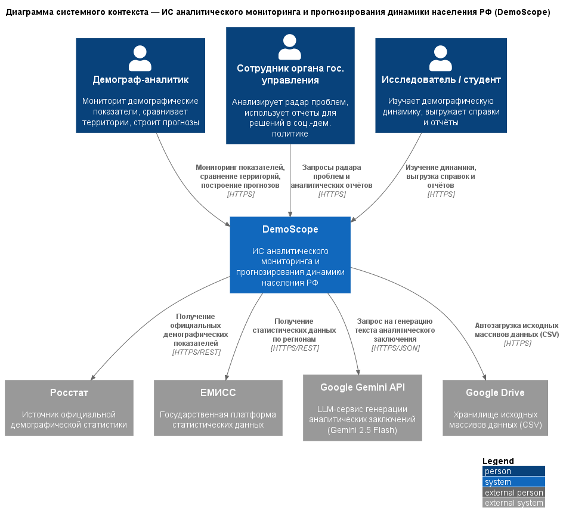
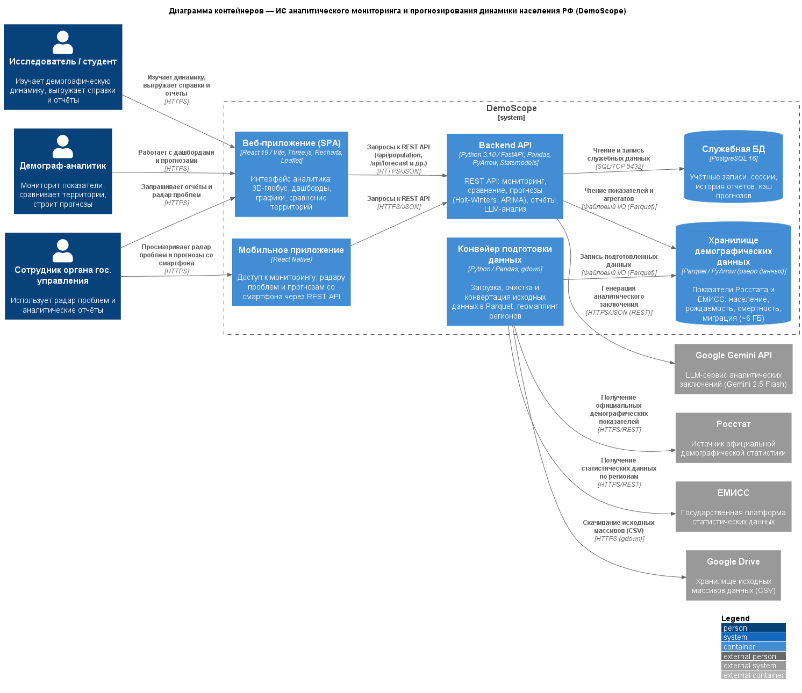

# Отчёт по лабораторной работе №1

**Дисциплина:** Информационные системы и технологии (ИСИТ, 3 семестр)
**Тема лабораторной работы:** C4 Model. Диаграмма системного контекста (Level 1) и диаграмма контейнеров (Level 2)
**Тема курсового проекта:** Разработка информационной системы аналитического мониторинга и прогнозирования динамики населения РФ
**Студент:** Бектеев Георгий, группа ИДБ-23-13 (Команда 18, роль — Тимлид)
**Преподаватель:** Бычков Сергей Юрьевич

---

## 1. Цель работы

Получить практические навыки проектирования архитектуры программной системы с использованием методологии C4 Model: научиться очерчивать жёсткие внешние границы проектируемой системы на диаграмме системного контекста (Level 1) и выполнять декомпозицию системы на независимо развёртываемые технологические контейнеры на диаграмме контейнеров (Level 2). Освоить подход Diagrams-as-Code — описание архитектуры в текстовом формате PlantUML с библиотекой C4-PlantUML.

## 2. Постановка задачи

В соответствии с методическим пособием в рамках лабораторной работы №1 необходимо:

1. Разработать **диаграмму системного контекста** (System Context Diagram), в которой проектируемая система представлена единым неделимым «чёрным ящиком»; диаграмма должна содержать центральный блок, не менее трёх пользовательских ролей (персон) и не менее трёх внешних программных или аппаратных систем, находящихся вне зоны прямого контроля разработчиков; все связи между элементами должны быть строго направленными и снабжены текстовым описанием передаваемых данных.
2. Разработать **диаграмму контейнеров** (Container Diagram), выполнив декомпозицию центрального системного блока на обособленные, независимо развёртываемые исполняемые сущности; выделить не менее пяти технологических контейнеров (включая мобильное и веб-приложение, бэкенд-сервисы и хранилища данных); для каждого контейнера зафиксировать конкретный технологический стек; для всех межсервисных связей указать используемые сетевые протоколы взаимодействия; сформировать таблицу описания контейнеров.
3. Оформить отчёт по лабораторной работе.

## 3. Исходные данные. Общая характеристика системы

Объектом архитектурного моделирования является информационная система **DemoScope** — платформа демографической аналитики, предназначенная для мониторинга, анализа и прогнозирования демографической ситуации в субъектах Российской Федерации.

Система решает следующие задачи:

- консолидация демографических и социально-экономических показателей Росстата и ЕМИСС (численность населения, рождаемость, смертность, миграция, заработная плата) в едином хранилище;
- интерактивная визуализация данных (тепловые карты, 3D-глобус, динамические графики) и сравнение территорий;
- прогнозирование динамики населения методами Holt-Winters, ARIMA и когортно-компонентным методом с расчётом доверительных интервалов;
- выявление проблемных территорий («радар проблем») на основе предиктивных алертов;
- автоматическая генерация аналитических справок, в том числе с использованием большой языковой модели (Google Gemini).

Курсовой проект выполняется командой №18 (тимлид — Бектеев Г.А., back-end — Алибеков А., tech-doc — Лиджиев Э.С., front-end — Слисаренко Д., analyst — Сырлыбаев Б.С.) и находится на этапе архитектурного проектирования: состав подсистем задаётся целевым образом, а реализация ведётся поэтапно в рамках спринтов, поэтому отдельные компоненты (в частности, мобильное приложение) находятся в стадии разработки. Целевая архитектура проектируется на стеке Python/FastAPI (backend) и React (frontend); демографические массивы хранятся в озере данных формата Parquet, служебные данные — в СУБД PostgreSQL. Архитектура описывается как код (Diagrams-as-Code) в нотации C4-PlantUML.

## 4. Диаграмма системного контекста (Level 1)

Диаграмма системного контекста показывает проектируемую систему в её окружении с «высоты птичьего полёта»: система представлена единым неделимым «чёрным ящиком», внутреннее устройство на данном уровне абстракции не раскрывается. Диаграмма отвечает на вопрос, какую ценность система предоставляет пользователям и с какими внешними системами она взаимодействует.

*Рисунок 1 — Диаграмма системного контекста системы DemoScope*

### 4.1. Спецификация элементов

| Элемент | Тип (C4) | Описание |
|---|---|---|
| Демограф-аналитик | Person | Основной пользователь системы: мониторит демографические показатели, сравнивает территории, строит прогнозы |
| Сотрудник органа государственного управления | Person | Использует «радар проблем» и аналитические отчёты для принятия решений в области социально-демографической политики |
| Исследователь / студент | Person | Изучает демографическую динамику, выгружает справки и отчёты |
| DemoScope | Software System | Проектируемая система: мониторинг, анализ и прогнозирование динамики населения РФ |
| Росстат | External System | Источник официальной демографической статистики |
| ЕМИСС | External System | Государственная платформа статистических данных |
| Google Gemini API | External System | LLM-сервис генерации аналитических заключений (Gemini 2.5 Flash) |
| Google Drive | External System | Хранилище исходных массивов данных (CSV), используемое конвейером загрузки |

### 4.2. Спецификация связей

| Инициатор | Получатель | Передаваемые данные / бизнес-действие | Протокол |
|---|---|---|---|
| Демограф-аналитик | DemoScope | Запросы мониторинга показателей, сравнения территорий, построения прогнозов | HTTPS |
| Сотрудник органа гос. управления | DemoScope | Запросы «радара проблем» и аналитических отчётов | HTTPS |
| Исследователь / студент | DemoScope | Запросы на изучение динамики, выгрузку справок и отчётов | HTTPS |
| DemoScope | Росстат | Запросы официальных демографических показателей | HTTPS/REST |
| DemoScope | ЕМИСС | Запросы статистических данных по регионам | HTTPS/REST |
| DemoScope | Google Gemini API | Запрос на генерацию текста аналитического заключения | HTTPS/JSON |
| DemoScope | Google Drive | Автозагрузка исходных массивов данных (CSV) | HTTPS |

Все связи однонаправленные: направление стрелки отражает инициатора запроса и направление движения данных. Система является «чёрным ящиком»: внутренние контейнеры и компоненты на данном уровне не показываются.

## 5. Диаграмма контейнеров (Level 2)

Диаграмма контейнеров раскрывает внутреннюю структуру «чёрного ящика»: центральный блок декомпозирован на обособленные, независимо развёртываемые исполняемые сущности. Контейнер в терминологии C4 — не Docker-контейнер, а приложение или хранилище данных, которое должно выполняться для работы всей системы. Для каждого контейнера зафиксирован конкретный технологический стек, для всех межсервисных связей указаны протоколы взаимодействия.

*Рисунок 2 — Диаграмма контейнеров системы DemoScope*

### 5.1. Таблица описания контейнеров

| ID | Контейнер | Тип (C4) | Технологический стек | Назначение |
|---|---|---|---|---|
| `web_app` | Веб-приложение (SPA) | Container | React 19 / Vite, Three.js, Recharts, Leaflet | Основной интерфейс пользователя: 3D-глобус, тепловые карты, дашборды, графики, сравнение территорий |
| `mobile_app` | Мобильное приложение | Container | React Native | Доступ к мониторингу и прогнозам со смартфона через единый REST API backend-контейнера |
| `api_backend` | Backend API | Container | Python 3.10 / FastAPI, Pandas, PyArrow, Statsmodels | Исполняемое ядро бизнес-логики: REST API мониторинга, сравнения территорий, прогнозирования, генерации отчётов, LLM-анализа |
| `data_pipeline` | Конвейер подготовки данных | Container | Python / Pandas, gdown | Служебные утилиты: загрузка исходных массивов, очистка, конвертация CSV → Parquet, геомаппинг регионов |
| `data_store` | Хранилище демографических данных | ContainerDb | Parquet / PyArrow (озеро данных) | Хранение показателей Росстата и ЕМИСС: население, рождаемость, смертность, миграция (~6 ГБ) |
| `db_service` | Служебная БД | ContainerDb | PostgreSQL 16 | Учётные записи и сессии пользователей, история сформированных отчётов, кэш результатов прогнозов |

### 5.2. Спецификация связей

| Инициатор | Получатель | Передаваемые данные / бизнес-действие | Протокол |
|---|---|---|---|
| Демограф-аналитик | `web_app` | Работа с дашбордами и прогнозами | HTTPS |
| Сотрудник органа гос. управления | `web_app` | Запросы отчётов и «радара проблем» | HTTPS |
| Сотрудник органа гос. управления | `mobile_app` | Просмотр «радара проблем» и прогнозов со смартфона | HTTPS |
| Исследователь / студент | `web_app` | Изучение динамики, выгрузка справок и отчётов | HTTPS |
| `web_app` | `api_backend` | Запросы к REST API (`/api/population`, `/api/forecast`, `/api/report` и др.) | HTTPS/JSON |
| `mobile_app` | `api_backend` | Запросы к REST API | HTTPS/JSON |
| `api_backend` | `data_store` | Чтение показателей и агрегатов | Файловый I/O (Parquet) |
| `api_backend` | `db_service` | Чтение и запись служебных данных | SQL/TCP 5432 |
| `data_pipeline` | `data_store` | Запись подготовленных данных | Файловый I/O (Parquet) |
| `data_pipeline` | Росстат | Получение официальных демографических показателей | HTTPS/REST |
| `data_pipeline` | ЕМИСС | Получение статистических данных по регионам | HTTPS/REST |
| `data_pipeline` | Google Drive | Скачивание исходных массивов (CSV) | HTTPS (gdown) |
| `api_backend` | Google Gemini API | Генерация аналитического заключения | HTTPS/JSON (REST) |

### 5.3. Обоснование архитектурных решений

1. **Разделение интерфейсного и сервисного слоёв.** Веб-приложение вынесено в отдельный контейнер: оно независимо развёртывается (статическая сборка Vite) и обращается к бэкенду только через REST API, что обеспечивает слабую связанность клиентского и серверного слоёв.
2. **Отдельный контейнер конвейера данных.** Подготовка данных (загрузка, очистка, конвертация) выполняется офлайн-утилитами, не входящими в исполняемый процесс API: конвейер может запускаться по расписанию независимо от работы сервиса, что соответствует принципу единственной ответственности на уровне развёртывания.
3. **Двухуровневая модель данных.** Аналитическая нагрузка системы — редкие чтения больших неизменяемых массивов — обслуживается озером данных на колоночном формате Parquet, обрабатываемым PyArrow «в памяти»: это обеспечивает высокую производительность аналитических выборок без администрирования тяжёлой СУБД. Служебные же данные (учётные записи, сессии, история отчётов, кэш прогнозов) хранятся в PostgreSQL — транзакционность гарантирована, а межсервисная связь с БД выполняется по стандартному сетевому протоколу SQL/TCP 5432.
4. **Мобильное приложение в контуре системы.** Курсовой проект находится на этапе архитектурного проектирования: состав контейнеров задаётся целевым образом и наполняется реализацией поэтапно (спринты проекта). Мобильное приложение включено в архитектуру наравне с веб-приложением и разделяет с ним единый REST API: стек React Native переиспользует компетенции команды (React 19) и не влечёт изменений в остальных контейнерах.
5. **Внешние LLM-интеграции за границей системы.** Генерация аналитических заключений выполняется внешним сервисом Google Gemini: система не содержит собственной модели, что отражено выносом API за границу `System_Boundary`.

## 6. Глоссарий идентификаторов (Glossary IDs)

Единые текстовые идентификаторы элементов, используемые во всех диаграммах проекта:

| ID | Элемент | Тип |
|---|---|---|
| `analyst` | Демограф-аналитик | Пользователь |
| `official` | Сотрудник органа гос. управления | Пользователь |
| `researcher` | Исследователь / студент | Пользователь |
| `demoscope` | DemoScope (граница системы) | Software System |
| `web_app` | Веб-приложение (SPA) | Контейнер |
| `mobile_app` | Мобильное приложение | Контейнер |
| `api_backend` | Backend API | Контейнер |
| `data_pipeline` | Конвейер подготовки данных | Контейнер |
| `data_store` | Хранилище демографических данных | Контейнер (БД) |
| `db_service` | Служебная БД (PostgreSQL) | Контейнер (БД) |
| `rosstat` | Росстат | Внешняя система |
| `emiss` | ЕМИСС | Внешняя система |
| `gemini_api` | Google Gemini API | Внешняя система |
| `gdrive` | Google Drive | Внешняя система |

## 7. Соответствие требованиям методического пособия

| Требование | Выполнение |
|---|---|
| Система — единый неделимый «чёрный ящик» на L1 | ✅ внутренняя структура на L1 не раскрывается |
| Центральный блок + ≥ 3 пользовательских ролей | ✅ 3 персоны |
| ≥ 3 внешних систем вне зоны контроля разработчиков | ✅ 4 внешние системы |
| Все связи строго направленные, с описанием данных | ✅ 7 направленных связей с описаниями и протоколами |
| Декомпозиция центрального блока на контейнеры (L2) | ✅ 6 контейнеров |
| ≥ 5 технологических контейнеров, включая мобильное и веб-приложение, бэкенд, хранилища | ✅ все обязательные категории представлены: веб- и мобильное приложение, Backend API, конвейер данных, озеро данных Parquet и служебная БД PostgreSQL |
| Технологический стек для каждого контейнера | ✅ зафиксирован в таблице контейнеров |
| Сетевые протоколы для всех межсервисных связей | ✅ указаны для каждой связи (HTTPS, HTTPS/JSON, SQL/TCP 5432, файловый I/O озера данных) |
| Таблица описания контейнеров | ✅ п. 5.1 |
| Инструмент — PlantUML + C4-PlantUML | ✅ макросы `Person`, `System`, `System_Ext`, `Container`, `ContainerDb`, `Rel`, `LAYOUT_WITH_LEGEND`, `LAYOUT_LEFT_RIGHT` |
| Запреты: только `Rel()`; без `skinparam` | ✅ нарушений нет |

## 8. Выводы

В ходе лабораторной работы освоены первые два уровня абстракции модели C4 применительно к теме курсового проекта. Построена диаграмма системного контекста, очерчивающая жёсткие внешние границы системы DemoScope: три пользовательские роли, четыре внешние системы и семь направленных информационных потоков с указанием протоколов. Выполнена декомпозиция системы на шесть технологических контейнеров с фиксацией стека и протоколов межсервисного взаимодействия. Архитектурное описание оформлено в подходе Diagrams-as-Code: диаграммы описаны текстом в нотации C4-PlantUML, версионируются и автоматически рендерятся в графические изображения. Полученные диаграммы образуют базу для последующих уровней детализации: декомпозиции бэкенда на компоненты (Level 3) и проектирования классов (Level 4).
