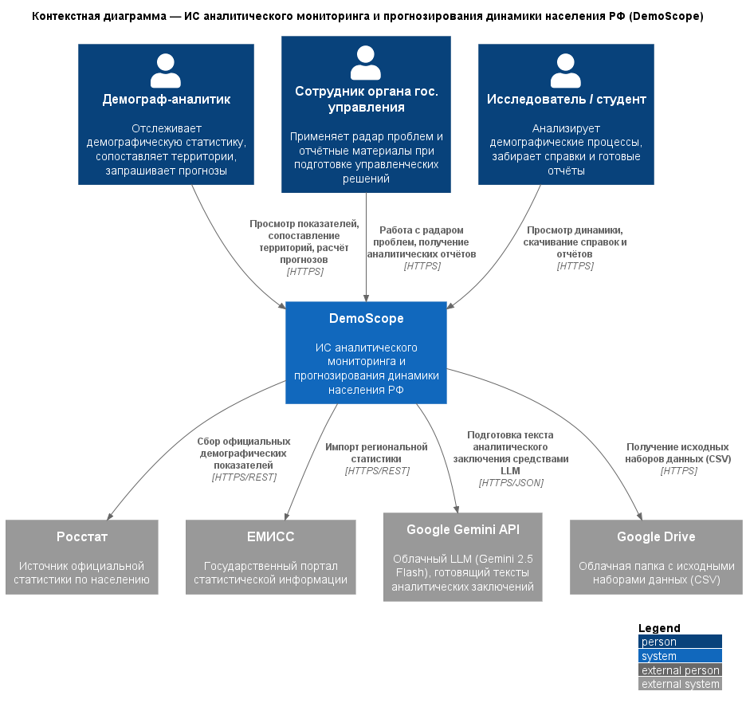
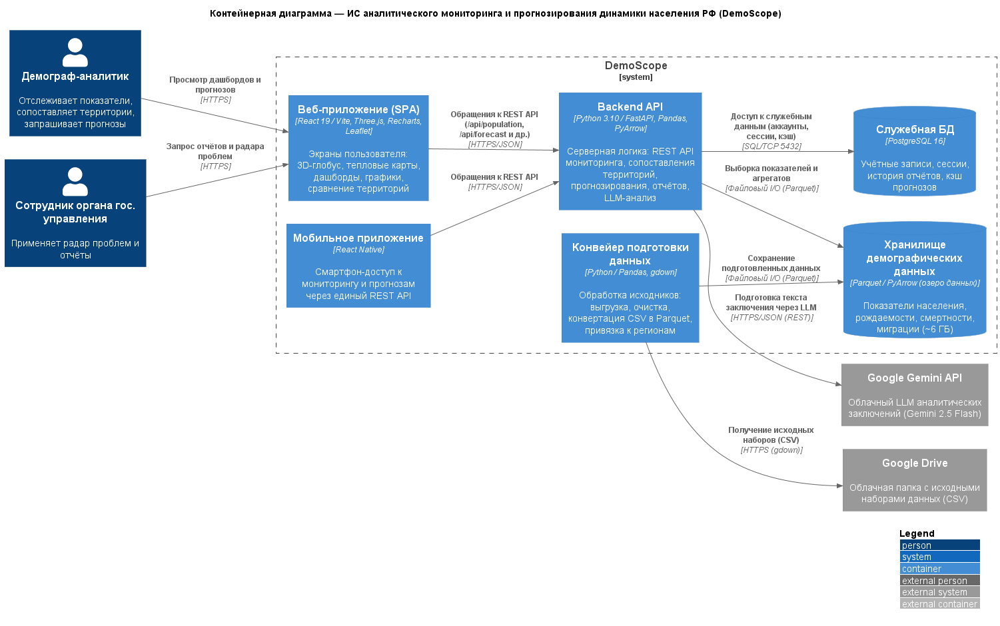

# Отчёт по лабораторной работе №1

**Дисциплина:** Информационные системы и технологии (ИСИТ, 3 семестр)
**Тема лабораторной работы:** C4 Model. Диаграмма системного контекста и диаграмма контейнеров
**Тема курсового проекта:** Разработка информационной системы аналитического мониторинга и прогнозирования динамики населения РФ

> Заполни перед сдачей: ФИО ____________, группа ____________, дата ____________

---

## 1. Цель работы

В рамках лабораторной работы осваивается методология C4 Model применительно к архитектуре собственного курсового проекта. Ставятся две практические задачи: закрепить внешние границы системы на диаграмме системного контекста (Level 1) и разделить систему на независимо развёртываемые технологические контейнеры на диаграмме контейнеров (Level 2). Попутно отрабатывается инженерная практика Diagrams-as-Code: архитектурные схемы хранятся в текстовом виде (PlantUML с библиотекой C4-PlantUML) и рендерятся в PNG автоматически, что позволяет держать их в системе контроля версий рядом с программным кодом.

## 2. Постановка задачи

Лабораторная работа №1 по методическому пособию состоит из трёх частей:

1) **контекстная диаграмма** (System Context Diagram). Проектируемая система изображается одним неделимым «чёрным ящиком»; на схеме присутствуют центральный блок, минимум три пользовательские роли и минимум три внешние программные или аппаратные системы, не контролируемые командой; все связи задаются направленными и снабжаются описанием передаваемых данных;

2) **контейнерная диаграмма** (Container Diagram). «Чёрный ящик» декомпозируется на обособленные, независимо развёртываемые исполняемые сущности; требуется выделить не меньше пяти технологических контейнеров (обязательны веб-приложение, мобильное приложение, серверные сервисы и хранилища данных), определить стек каждого контейнера и указать сетевые протоколы всех межсервисных взаимодействий; результаты сводятся в таблицу описания контейнеров;

3) оформление отчёта по лабораторной работе.

## 3. Исходные данные. Общая характеристика системы

Объект моделирования — информационная система **DemoScope**, платформа демографической аналитики для мониторинга, исследования и прогнозирования демографической обстановки в регионах Российской Федерации.

Ключевые функции системы:

- консолидация показателей Росстата и ЕМИСС (население, рождаемость, смертность, миграция, заработная плата) в едином хранилище;
- наглядная визуализация: тепловые карты, 3D-глобус, динамические графики, режим сопоставления территорий;
- прогнозная аналитика численности населения: модели Хольта-Уинтерса и ARIMA, когортно-компонентный метод, доверительные интервалы;
- «радар проблем» — автоматическое выявление неблагополучных территорий по предиктивным алертам;
- генерация аналитических справок, включая автоматический текст от большой языковой модели (Google Gemini).

Проект находится на этапе архитектурного проектирования: состав подсистем определяется целевым образом, реализация идёт поэтапно (спринты), поэтому отдельные части — например, мобильное приложение — пока в разработке. Целевая архитектура: Python/FastAPI (сервер) и React (клиент); демографические массивы размещаются в озере данных формата Parquet, служебные данные — в СУБД PostgreSQL. Архитектурные схемы ведутся как код в нотации C4-PlantUML.

## 4. Диаграмма системного контекста (Level 1)

Уровень системного контекста отвечает на два вопроса: кому система полезна и чем она обменивается с внешним миром. DemoScope изображён одним цельным блоком — «чёрным ящиком», без деталей внутреннего устройства; вокруг него показаны пользовательские роли и внешние системы со строго направленными потоками данных.

*Рисунок 1 — Диаграмма системного контекста системы DemoScope*

### 4.1. Спецификация элементов

| Элемент | Тип (C4) | Описание |
|---|---|---|
| Демограф-аналитик | Person | Главный пользователь: следит за демографическими показателями, сопоставляет территории, заказывает прогнозы |
| Сотрудник органа государственного управления | Person | Работает с «радаром проблем» и отчётными материалами при подготовке мер социально-демографической политики |
| Исследователь / студент | Person | Анализирует демографические процессы, забирает справки и готовые отчёты |
| DemoScope | Software System | Моделируемая платформа: мониторинг, анализ и прогнозирование динамики населения РФ |
| Росстат | External System | Первоисточник официальной статистики по населению |
| ЕМИСС | External System | Государственный портал статистических показателей |
| Google Gemini API | External System | Облачный LLM (Gemini 2.5 Flash), готовящий тексты аналитических заключений |
| Google Drive | External System | Облачное хранилище исходных наборов данных (CSV) для конвейера загрузки |

### 4.2. Спецификация связей

| Инициатор | Получатель | Передаваемые данные / бизнес-действие | Протокол |
|---|---|---|---|
| Демограф-аналитик | DemoScope | Просмотр показателей, сопоставление территорий, расчёт прогнозов | HTTPS |
| Сотрудник органа гос. управления | DemoScope | Работа с «радаром проблем», получение аналитических отчётов | HTTPS |
| Исследователь / студент | DemoScope | Просмотр динамики, скачивание справок и отчётов | HTTPS |
| DemoScope | Росстат | Сбор официальных демографических показателей | HTTPS/REST |
| DemoScope | ЕМИСС | Импорт региональной статистики | HTTPS/REST |
| DemoScope | Google Gemini API | Подготовка текста аналитического заключения средствами LLM | HTTPS/JSON |
| DemoScope | Google Drive | Получение исходных наборов данных (CSV) | HTTPS |

Направление каждой стрелки задаёт инициатора обмена; двусторонних связей на уровне контекста нет. Внутреннее устройство системы — контейнеры, компоненты — на этой диаграмме не раскрывается по определению уровня L1.

## 5. Диаграмма контейнеров (Level 2)

Контейнерная диаграмма показывает, из каких независимо развёртываемых частей собран «чёрный ящик» L1. Важно, что «контейнер» здесь — термин C4: это исполняемое приложение или хранилище данных, а не единица Docker. Для каждой части указан технологический стек, для каждой связи — протокол.

*Рисунок 2 — Диаграмма контейнеров системы DemoScope*

### 5.1. Таблица описания контейнеров

| ID | Контейнер | Тип (C4) | Технологический стек | Назначение |
|---|---|---|---|---|
| `web_app` | Веб-приложение (SPA) | Container | React 19 / Vite, Three.js, Recharts, Leaflet | Экраны пользователя: 3D-глобус, тепловые карты, дашборды, графики, режим сравнения территорий |
| `mobile_app` | Мобильное приложение | Container | React Native | Смартфон-доступ к мониторингу и прогнозам через единый REST API backend-контейнера |
| `api_backend` | Backend API | Container | Python 3.10 / FastAPI, Pandas, PyArrow, Statsmodels | Серверная логика: REST API мониторинга, сопоставления территорий, прогнозирования, отчётов и LLM-анализа |
| `data_pipeline` | Конвейер подготовки данных | Container | Python / Pandas, gdown | Сервисные утилиты: выгрузка исходников, очистка, перекодирование CSV в Parquet, геомаппинг регионов |
| `data_store` | Хранилище демографических данных | ContainerDb | Parquet / PyArrow (озеро данных) | Массивы показателей Росстата и ЕМИСС: население, рождаемость, смертность, миграция (~6 ГБ) |
| `db_service` | Служебная БД | ContainerDb | PostgreSQL 16 | Учётные записи и сессии пользователей, история сформированных отчётов, кэш результатов прогнозов |

### 5.2. Спецификация связей

| Инициатор | Получатель | Передаваемые данные / бизнес-действие | Протокол |
|---|---|---|---|
| Демограф-аналитик | `web_app` | Просмотр дашбордов и прогнозов | HTTPS |
| Сотрудник органа гос. управления | `web_app` | Запрос отчётов и «радара проблем» | HTTPS |
| `web_app` | `api_backend` | Обращения к REST API (`/api/population`, `/api/forecast`, `/api/report` и др.) | HTTPS/JSON |
| `mobile_app` | `api_backend` | Обращения к REST API | HTTPS/JSON |
| `api_backend` | `data_store` | Выборка показателей и агрегатов | Файловый I/O (Parquet) |
| `api_backend` | `db_service` | Доступ к служебным данным (аккаунты, сессии, кэш) | SQL/TCP 5432 |
| `data_pipeline` | `data_store` | Сохранение подготовленных данных | Файловый I/O (Parquet) |
| `data_pipeline` | Google Drive | Получение исходных наборов (CSV) | HTTPS (gdown) |
| `api_backend` | Google Gemini API | Подготовка текста заключения через LLM | HTTPS/JSON (REST) |

### 5.3. Обоснование архитектурных решений

1. **Клиент отделён от сервера.** Веб-приложение живёт в собственном контейнере и доставляется как статическая сборка Vite; единственный канал к серверной логике — REST API. Клиент и сервер можно обновлять независимо друг от друга.
2. **Подготовка данных не нагружает API.** Загрузка, очистка и конвертация массивов вынесены в отдельные офлайн-утилиты: конвейер стартует по расписанию сам по себе и не влияет на работающий сервис. Каждый компонент отвечает за одно дело — уже на уровне развёртывания.
3. **Двухуровневая организация данных.** Редкие чтения крупных неизменяемых массивов обслуживает озеро данных на колоночном Parquet под управлением PyArrow «в памяти» — высокая скорость аналитических выборок без администрирования тяжёлой СУБД. Служебные же данные (учётные записи, сессии, история отчётов, кэш прогнозов) живут в PostgreSQL: транзакционность гарантирована СУБД, а связь идёт по стандартному сетевому протоколу SQL/TCP 5432.
4. **Мобильное приложение в контуре системы.** Проект проходит стадию архитектурного проектирования: контейнеры задаются целевыми и наполняются реализацией по спринтам. Мобильный клиент стоит в архитектуре наравне с веб-приложением и делит с ним единый REST API; стек React Native опирается на накопленные компетенции команды (React 19) и не требует правок остальных контейнеров.
5. **Генерация текстов — снаружи.** Аналитические заключения пишет внешний сервис Google Gemini; собственной модели в системе нет, поэтому её API вынесен за границу `System_Boundary`.

## 6. Глоссарий идентификаторов (Glossary IDs)

Список сквозных идентификаторов, применяемых во всех схемах проекта:

| ID | Элемент | Тип |
|---|---|---|
| `analyst` | Демограф-аналитик | Пользователь |
| `official` | Сотрудник органа гос. управления | Пользователь |
| `researcher` | Исследователь / студент | Пользователь |
| `demoscope` | DemoScope (граница системы) | Software System |
| `web_app` | Веб-приложение (SPA) | Контейнер |
| `mobile_app` | Мобильное приложение | Контейнер |
| `api_backend` | Backend API | Контейнер |
| `data_pipeline` | Конвейер подготовки данных | Контейнер |
| `data_store` | Хранилище демографических данных | Контейнер (БД) |
| `db_service` | Служебная БД (PostgreSQL) | Контейнер (БД) |
| `rosstat` | Росстат | Внешняя система |
| `emiss` | ЕМИСС | Внешняя система |
| `gemini_api` | Google Gemini API | Внешняя система |
| `gdrive` | Google Drive | Внешняя система |

## 7. Соответствие требованиям методического пособия

| Требование | Выполнение |
|---|---|
| Система — единый неделимый «чёрный ящик» на L1 | ✅ внутренности системы на L1 не показываются |
| Центральный блок + ≥ 3 пользовательских ролей | ✅ 3 персоны |
| ≥ 3 внешних систем вне зоны контроля разработчиков | ✅ 4 внешние системы |
| Все связи строго направленные, с описанием данных | ✅ 7 направленных связей, у каждой описание и протокол |
| Декомпозиция центрального блока на контейнеры (L2) | ✅ 6 контейнеров |
| ≥ 5 технологических контейнеров, включая мобильное и веб-приложение, бэкенд, хранилища | ✅ все обязательные категории на месте: веб- и мобильное приложение, Backend API, конвейер данных, озеро данных Parquet и служебная БД PostgreSQL |
| Технологический стек для каждого контейнера | ✅ указан в таблице контейнеров |
| Сетевые протоколы для всех межсервисных связей | ✅ протокол есть у каждой связи (HTTPS, HTTPS/JSON, SQL/TCP 5432, файловый I/O озера данных) |
| Таблица описания контейнеров | ✅ п. 5.1 |
| Инструмент — PlantUML + C4-PlantUML | ✅ задействованы макросы `Person`, `System`, `System_Ext`, `Container`, `ContainerDb`, `Rel`, `LAYOUT_WITH_LEGEND`, `LAYOUT_LEFT_RIGHT` |
| Запреты: только `Rel()`; без `skinparam` | ✅ нарушений нет |

## 8. Выводы

Лабораторная работа дала практику применения C4 Model к курсовому проекту. На уровне контекста зафиксированы внешние границы DemoScope: три роли пользователей, четыре внешние системы, семь однонаправленных потоков данных с протоколами. На уровне контейнеров система разложена на шесть независимо развёртываемых частей, для каждой определён стек, для каждой межсервисной связи — протокол. Схемы оформлены в Diagrams-as-Code: их исходники лежат в репозитории рядом с кодом и автоматически превращаются в PNG, поэтому архитектура версионируется вместе с разработкой. Построенные уровни станут отправной точкой для Level 3 (компоненты бэкенда) и Level 4 (классы).
