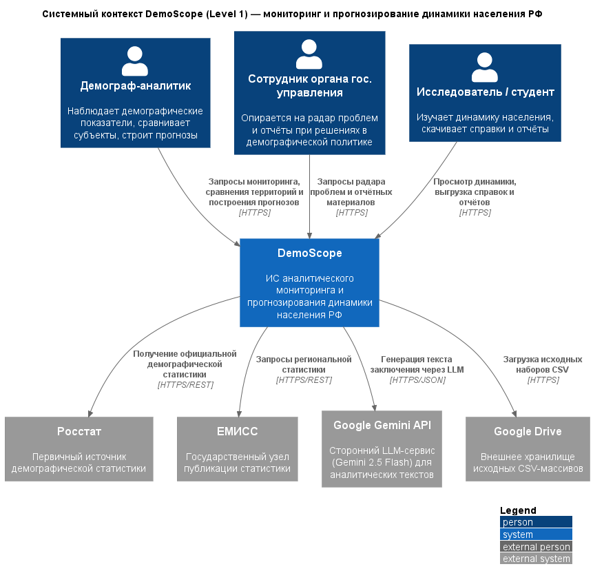
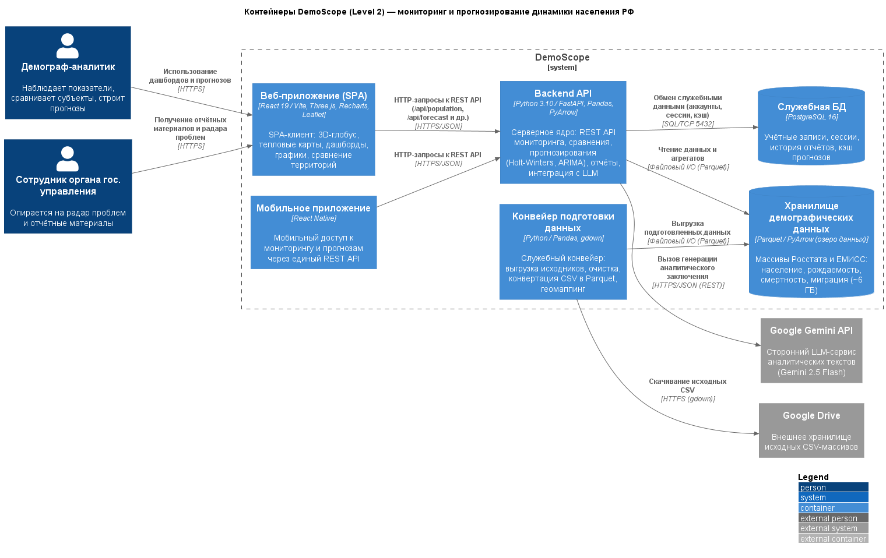

# Отчёт по лабораторной работе №1

**Дисциплина:** Информационные системы и технологии (ИСИТ, 3 семестр)
**Тема лабораторной работы:** C4 Model. Диаграмма системного контекста и диаграмма контейнеров
**Тема курсового проекта:** Разработка информационной системы аналитического мониторинга и прогнозирования динамики населения РФ

> Заполни перед сдачей: ФИО ____________, группа ____________, дата ____________

---

## 1. Цель работы

Лабораторная работа посвящена архитектурному описанию программной системы средствами C4 Model. Требуется научиться отделять систему от её окружения (диаграмма системного контекста, Level 1) и расчленять её на независимо развёртываемые исполняемые единицы (диаграмма контейнеров, Level 2). Дополнительная задача — внедрить в повседневную работу принцип Diagrams-as-Code: схемы пишутся текстом в PlantUML с библиотекой C4-PlantUML и автоматически собираются в изображения, как обычный исходный код.

## 2. Постановка задачи

Из методического пособия следуют три требования к работе №1:

1) **системный контекст** (System Context Diagram): система показывается цельным «чёрным ящиком»; схема обязана содержать центральный блок, не меньше трёх персон-пользователей и не меньше трёх внешних систем за пределами влияния команды; каждая связь направленная и подписана составом передаваемых данных;

2) **контейнеры** (Container Diagram): центральный блок раскрывается на обособленные, независимо развёртываемые сущности; минимум пять контейнеров (среди них обязательно веб-приложение, мобильное приложение, серверные сервисы, хранилища данных); у каждого контейнера — конкретный технологический стек, у каждой межсервисной связи — сетевой протокол; оформляется таблица контейнеров;

3) подготовка отчёта по работе.

## 3. Исходные данные. Общая характеристика системы

Моделируется информационная система **DemoScope** — демографическая аналитическая платформа, которая собирает, наглядно представляет и прогнозирует демографическую картину субъектов Российской Федерации.

Система покрывает следующий функционал:

- сведение показателей Росстата и ЕМИСС (численность населения, рождаемость, смертность, миграция, заработная плата) в единое хранилище;
- интерактивные представления: тепловые карты, 3D-глобус, динамические графики, сравнение территорий;
- прогнозирование населения методами Хольта-Уинтерса и ARIMA, когортно-компонентный метод, доверительные интервалы;
- «радар проблем» — предиктивные алерты о неблагополучных территориях;
- автоматическая выписка аналитических справок с подключением большой языковой модели Google Gemini.

Проект пребывает на стадии архитектурного проектирования: контуры подсистем зафиксированы целевым образом, наполнение кодом идёт спринтами, поэтому некоторые части (например, мобильный клиент) ещё реализуются. Целевой стек: Python/FastAPI на сервере, React на клиенте; демографические массивы — в озере данных Parquet, служебные данные — в PostgreSQL. Схемы архитектуры поддерживаются как код (нотация C4-PlantUML).

## 4. Диаграмма системного контекста (Level 1)

Диаграмма контекста рисует DemoScope одним сплошным блоком: внутренности скрыты, показаны только граничные взаимодействия. Именно она фиксирует, какие роли пользуются системой и какие внешние сервисы ей необходимы.

*Рисунок 1 — Диаграмма системного контекста системы DemoScope*

### 4.1. Спецификация элементов

| Элемент | Тип (C4) | Описание |
|---|---|---|
| Демограф-аналитик | Person | Основной потребитель системы: наблюдает демографические показатели, сравнивает субъекты, строит прогнозы |
| Сотрудник органа государственного управления | Person | Берёт «радар проблем» и отчёты за основу решений в социально-демографической сфере |
| Исследователь / студент | Person | Изучает динамику населения, выгружает справочные и отчётные материалы |
| DemoScope | Software System | Архитектурируемая система: мониторинг, анализ и прогнозирование динамики населения РФ |
| Росстат | External System | Первичный источник официальной демографической статистики |
| ЕМИСС | External System | Государственный узел публикации статистических данных |
| Google Gemini API | External System | Сторонний LLM-сервис (Gemini 2.5 Flash) для аналитических текстов |
| Google Drive | External System | Внешнее хранилище исходных CSV-массивов |

### 4.2. Спецификация связей

| Инициатор | Получатель | Передаваемые данные / бизнес-действие | Протокол |
|---|---|---|---|
| Демограф-аналитик | DemoScope | Запросы мониторинга, сравнения территорий и построения прогнозов | HTTPS |
| Сотрудник органа гос. управления | DemoScope | Запросы «радара проблем» и отчётных материалов | HTTPS |
| Исследователь / студент | DemoScope | Просмотр динамики, выгрузка справок и отчётов | HTTPS |
| DemoScope | Росстат | Получение официальной демографической статистики | HTTPS/REST |
| DemoScope | ЕМИСС | Запросы региональной статистики | HTTPS/REST |
| DemoScope | Google Gemini API | Генерация текста заключения через LLM | HTTPS/JSON |
| DemoScope | Google Drive | Загрузка исходных наборов CSV | HTTPS |

Стрелка указывает инициатора и направление потока данных; обратных стрелок на уровне L1 нет. Внутренности системы (контейнеры, компоненты) здесь намеренно не показаны — это прерогатива следующих уровней модели.

## 5. Диаграмма контейнеров (Level 2)

На уровне контейнеров DemoScope расчленяется на самостоятельно развёртываемые единицы. Напомним: «контейнер» в C4 — не Docker, а любое приложение или хранилище данных, без которого система не работает как целое. Стек и протоколы зафиксированы по каждому элементу.

*Рисунок 2 — Диаграмма контейнеров системы DemoScope*

### 5.1. Таблица описания контейнеров

| ID | Контейнер | Тип (C4) | Технологический стек | Назначение |
|---|---|---|---|---|
| `web_app` | Веб-приложение (SPA) | Container | React 19 / Vite, Three.js, Recharts, Leaflet | SPA-клиент: 3D-глобус, тепловые карты, дашборды, графики, сравнение территорий |
| `mobile_app` | Мобильное приложение | Container | React Native | Мобильный доступ к мониторингу и прогнозам через единый REST API backend-контейнера |
| `api_backend` | Backend API | Container | Python 3.10 / FastAPI, Pandas, PyArrow, Statsmodels | Серверное ядро: REST API мониторинга, сравнения, прогнозирования, отчётов, интеграция с LLM |
| `data_pipeline` | Конвейер подготовки данных | Container | Python / Pandas, gdown | Служебный конвейер: выгрузка исходников, очистка, конвертация CSV в Parquet, геомаппинг регионов |
| `data_store` | Хранилище демографических данных | ContainerDb | Parquet / PyArrow (озеро данных) | Массивы Росстата и ЕМИСС: население, рождаемость, смертность, миграция (~6 ГБ) |
| `db_service` | Служебная БД | ContainerDb | PostgreSQL 16 | Профили и сессии пользователей, история отчётов, кэш прогнозов |

### 5.2. Спецификация связей

| Инициатор | Получатель | Передаваемые данные / бизнес-действие | Протокол |
|---|---|---|---|
| Демограф-аналитик | `web_app` | Использование дашбордов и прогнозов | HTTPS |
| Сотрудник органа гос. управления | `web_app` | Получение отчётных материалов и «радара проблем» | HTTPS |
| `web_app` | `api_backend` | HTTP-запросы к REST API (`/api/population`, `/api/forecast`, `/api/report` и др.) | HTTPS/JSON |
| `mobile_app` | `api_backend` | HTTP-запросы к REST API | HTTPS/JSON |
| `api_backend` | `data_store` | Чтение данных и агрегатов | Файловый I/O (Parquet) |
| `api_backend` | `db_service` | Обмен служебными данными (аккаунты, сессии, кэш) | SQL/TCP 5432 |
| `data_pipeline` | `data_store` | Выгрузка подготовленных данных | Файловый I/O (Parquet) |
| `data_pipeline` | Google Drive | Скачивание исходных CSV | HTTPS (gdown) |
| `api_backend` | Google Gemini API | Вызов генерации аналитического заключения | HTTPS/JSON (REST) |

### 5.3. Обоснование архитектурных решений

1. **Разнесённые фронтенд и бэкенд.** SPA собирается статикой (Vite) и живёт собственным циклом релизов; серверная логика доступна ему только через REST API. Минимальная связанность упрощает независимое обновление клиента и сервера.
2. **Конвейер данных вне процесса API.** Подготовка массивов (загрузка, очистка, конвертация) идёт офлайн-утилитами: планировщик запускает их отдельно, и сбой конвейера не валит сервис. Принцип единственной ответственности доведён до уровня развёртывания.
3. **Разделение хранилищ по назначению.** Аналитика читает редко, но много — для этого озеро данных на колоночном Parquet с обработкой PyArrow «в памяти»: максимум скорости без администрирования СУБД. Операционным данным (аккаунты, сессии, история отчётов, кэш прогнозов) нужны транзакции — им место в PostgreSQL, доступ по сетевому протоколу SQL/TCP 5432.
4. **Мобильный клиент в общем контуре.** Архитектура зафиксирована целевой, реализация распределена по спринтам; мобильное приложение занимает в схеме равное с веб-приложением место и ходит в тот же REST API. React Native достаёт компетенции команды из React 19 и не требует правок других контейнеров.
5. **LLM остаётся снаружи.** Тексты заключений выдаёт внешний Google Gemini; собственной модели в DemoScope нет, поэтому её API стоит за границей `System_Boundary`.

## 6. Глоссарий идентификаторов (Glossary IDs)

Перечень единых идентификаторов, которыми помечены элементы на всех диаграммах проекта:

| ID | Элемент | Тип |
|---|---|---|
| `analyst` | Демограф-аналитик | Пользователь |
| `official` | Сотрудник органа гос. управления | Пользователь |
| `researcher` | Исследователь / студент | Пользователь |
| `demoscope` | DemoScope (граница системы) | Software System |
| `web_app` | Веб-приложение (SPA) | Контейнер |
| `mobile_app` | Мобильное приложение | Контейнер |
| `api_backend` | Backend API | Контейнер |
| `data_pipeline` | Конвейер подготовки данных | Контейнер |
| `data_store` | Хранилище демографических данных | Контейнер (БД) |
| `db_service` | Служебная БД (PostgreSQL) | Контейнер (БД) |
| `rosstat` | Росстат | Внешняя система |
| `emiss` | ЕМИСС | Внешняя система |
| `gemini_api` | Google Gemini API | Внешняя система |
| `gdrive` | Google Drive | Внешняя система |

## 7. Соответствие требованиям методического пособия

| Требование | Выполнение |
|---|---|
| Система — единый неделимый «чёрный ящик» на L1 | ✅ L1 не раскрывает внутренности системы |
| Центральный блок + ≥ 3 пользовательских ролей | ✅ 3 персоны на схеме |
| ≥ 3 внешних систем вне зоны контроля разработчиков | ✅ 4 внешние системы за границей контроля |
| Все связи строго направленные, с описанием данных | ✅ 7 направленных связей, все с описанием и протоколом |
| Декомпозиция центрального блока на контейнеры (L2) | ✅ система разделена на 6 контейнеров |
| ≥ 5 технологических контейнеров, включая мобильное и веб-приложение, бэкенд, хранилища | ✅ обязательные типы контейнеров присутствуют: веб- и мобильное приложение, Backend API, конвейер данных, озеро данных Parquet и служебная БД PostgreSQL |
| Технологический стек для каждого контейнера | ✅ стек перечислен в таблице контейнеров |
| Сетевые протоколы для всех межсервисных связей | ✅ протокол проставлен у каждой связи (HTTPS, HTTPS/JSON, SQL/TCP 5432, файловый I/O озера данных) |
| Таблица описания контейнеров | ✅ п. 5.1 |
| Инструмент — PlantUML + C4-PlantUML | ✅ применены макросы `Person`, `System`, `System_Ext`, `Container`, `ContainerDb`, `Rel`, `LAYOUT_WITH_LEGEND`, `LAYOUT_LEFT_RIGHT` |
| Запреты: только `Rel()`; без `skinparam` | ✅ запрещённые конструкции не использовались |

## 8. Выводы

Отработаны уровни L1 и L2 методологии C4 на архитектуре курсового проекта. Контекстная диаграмма отделила DemoScope от окружения: три пользовательские роли, четыре внешние системы, семь однонаправленных потоков с протоколами. Контейнерная диаграмма разложила систему на шесть независимо развёртываемых единиц с указанием стека и протоколов взаимодействия. Диаграммы существуют в формате Diagrams-as-Code: исходники на C4-PlantUML хранятся в репозитории, PNG собираются автоматически, архитектура версионируется наравне с кодом. Далее следуют Level 3 (компонентная декомпозиция бэкенда) и Level 4 (проектирование классов).
