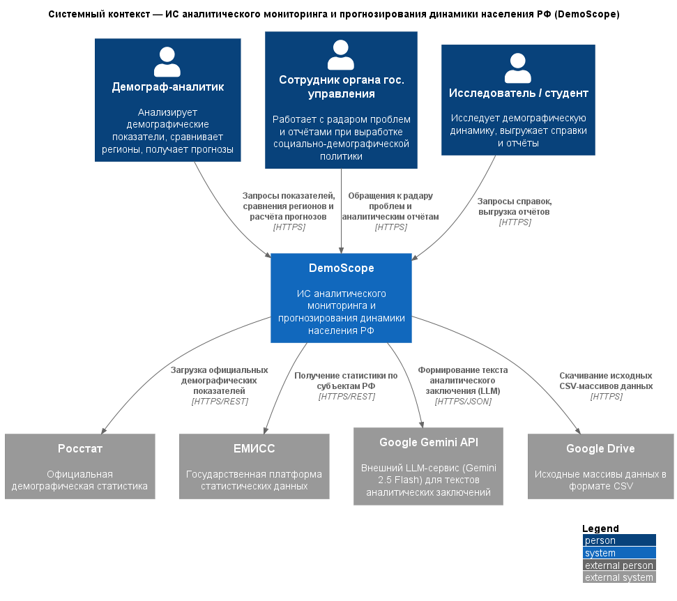
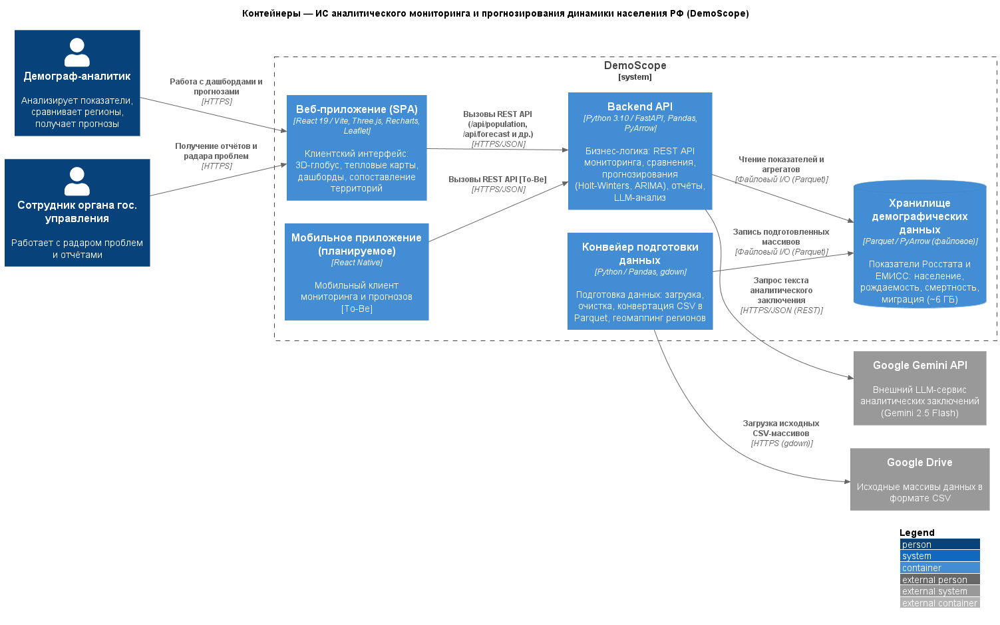

# Отчёт по лабораторной работе №1

**Дисциплина:** Информационные системы и технологии (ИСИТ, 3 семестр)
**Тема лабораторной работы:** C4 Model. Диаграмма системного контекста и диаграмма контейнеров
**Тема курсового проекта:** Разработка информационной системы аналитического мониторинга и прогнозирования динамики населения РФ

> Заполни перед сдачей: ФИО ____________, группа ____________, дата ____________

---

## 1. Цель работы

Цель работы — освоить методологию C4 Model как инструмент архитектурного проектирования программных систем. В ходе выполнения работы необходимо научиться фиксировать внешние границы проектируемой системы на диаграмме системного контекста (уровень 1) и декомпозировать систему на независимо развёртываемые технологические контейнеры на диаграмме контейнеров (уровень 2). Отдельное внимание уделяется практике Diagrams-as-Code: архитектурные схемы описываются в виде текста на языке PlantUML с подключением библиотеки C4-PlantUML и автоматически преобразуются в графические изображения, что позволяет версионировать архитектуру совместно с кодом проекта.

## 2. Постановка задачи

Согласно методическому пособию, в рамках лабораторной работы №1 требуется:

1) построить **диаграмму системного контекста** (System Context Diagram): проектируемая система изображается единым неделимым «чёрным ящиком»; в состав диаграммы входят центральный блок, не менее трёх ролей пользователей (персоны) и не менее трёх внешних программных или аппаратных систем, находящихся вне зоны контроля команды разработки; каждая связь должна быть направленной и сопровождаться описанием состава передаваемых данных;

2) построить **диаграмму контейнеров** (Container Diagram): раскрыть содержимое центрального блока, декомпозировав его на обособленные, независимо развёртываемые исполняемые сущности; выделить не менее пяти технологических контейнеров, среди которых должны быть веб-приложение, мобильное приложение, серверные сервисы и хранилища данных; для каждого контейнера указать технологический стек, для каждой межсервисной связи — сетевой протокол; дополнить диаграмму таблицей описания контейнеров;

3) оформить отчёт по результатам работы.

## 3. Исходные данные. Общая характеристика системы

Архитектурному моделированию подвергается информационная система **DemoScope** — платформа демографической аналитики, обеспечивающая мониторинг, анализ и прогнозирование демографической ситуации в субъектах Российской Федерации.

Назначение системы раскрывается через следующий круг задач:

- сбор в едином хранилище демографических и социально-экономических показателей, публикуемых Росстатом и ЕМИСС: численность населения, рождаемость, смертность, миграция, уровень заработной платы;
- интерактивное представление данных: тепловые карты, трёхмерный глобус, динамические графики, сопоставление территорий между собой;
- прогнозирование численности населения методами Хольта-Уинтерса, ARIMA и когортно-компонентным методом с построением доверительных интервалов;
- формирование «радара проблем» — выявления неблагополучных территорий на базе предиктивных алертов;
- автоматизированная подготовка аналитических справок, в том числе с привлечением большой языковой модели Google Gemini.

Серверная часть системы реализована на Python/FastAPI, клиентская — на React; данные хранятся в колоночном формате Parquet. Архитектурное описание ведётся в подходе Diagrams-as-Code средствами нотации C4-PlantUML.

## 4. Диаграмма системного контекста (Level 1)

На диаграмме системного контекста проектируемая система показана в окружении внешних участников с максимально высокого уровня абстракции: DemoScope условно «запечатан» в чёрный ящик, и его внутреннее устройство на схеме не раскрывается. Диаграмма фиксирует, какую ценность система несёт каждой пользовательской роли и через какие интерфейсы она обменивается данными с внешними системами.

*Рисунок 1 — Диаграмма системного контекста системы DemoScope*

### 4.1. Спецификация элементов

| Элемент | Тип (C4) | Описание |
|---|---|---|
| Демограф-аналитик | Person | Ключевая роль: отслеживает демографические показатели, сопоставляет регионы, запрашивает прогнозы |
| Сотрудник органа государственного управления | Person | Опирается на «радар проблем» и аналитические отчёты при выработке решений в социально-демографической политике |
| Исследователь / студент | Person | Изучает демографические процессы, выгружает справочные и отчётные материалы |
| DemoScope | Software System | Моделируемая система: мониторинг, анализ и прогнозирование динамики населения РФ |
| Росстат | External System | Поставщик официальной демографической статистики |
| ЕМИСС | External System | Государственная платформа публикации статистических данных |
| Google Gemini API | External System | Внешний LLM-сервис, формирующий тексты аналитических заключений (Gemini 2.5 Flash) |
| Google Drive | External System | Репозиторий исходных массивов данных (CSV), откуда их забирает конвейер загрузки |

### 4.2. Спецификация связей

| Инициатор | Получатель | Передаваемые данные / бизнес-действие | Протокол |
|---|---|---|---|
| Демограф-аналитик | DemoScope | Запросы показателей, сравнения регионов и расчёта прогнозов | HTTPS |
| Сотрудник органа гос. управления | DemoScope | Обращения к «радару проблем» и аналитическим отчётам | HTTPS |
| Исследователь / студент | DemoScope | Запросы справок, выгрузка отчётов | HTTPS |
| DemoScope | Росстат | Загрузка официальных демографических показателей | HTTPS/REST |
| DemoScope | ЕМИСС | Получение статистики по субъектам РФ | HTTPS/REST |
| DemoScope | Google Gemini API | Формирование текста аналитического заключения | HTTPS/JSON |
| DemoScope | Google Drive | Скачивание исходных CSV-массивов данных | HTTPS |

Каждая связь на диаграмме однонаправленная: стрелка показывает, кто инициировал обмен и в какую сторону движутся данные. Уровень L1 сознательно не раскрывает внутренности системы — ни контейнеры, ни компоненты здесь не изображаются.

## 5. Диаграмма контейнеров (Level 2)

Диаграмма контейнеров «открывает» чёрный ящик уровня L1: центральный блок разбит на независимо развёртываемые исполняемые сущности. Подчеркнём, что контейнер в терминах C4 — это не Docker-единица, а любое приложение или хранилище данных, необходимое для работы системы как целого. Технологический стек зафиксирован для каждого контейнера, а для каждой межсервисной связи указан применяемый протокол.

*Рисунок 2 — Диаграмма контейнеров системы DemoScope*

### 5.1. Таблица описания контейнеров

| ID | Контейнер | Тип (C4) | Технологический стек | Назначение |
|---|---|---|---|---|
| `web_app` | Веб-приложение (SPA) | Container | React 19 / Vite, Three.js, Recharts, Leaflet | Клиентский интерфейс: 3D-глобус, тепловые карты, дашборды, графики, сопоставление территорий |
| `mobile_app` | Мобильное приложение (планируемое) | Container | React Native | Мобильный клиент мониторинга и прогнозов. Контейнер уровня To-Be: принадлежит целевой архитектуре и находится в разработке |
| `api_backend` | Backend API | Container | Python 3.10 / FastAPI, Pandas, PyArrow, Statsmodels | Ядро бизнес-логики: REST API мониторинга, сопоставления территорий, прогнозирования, отчётности и LLM-анализа |
| `data_pipeline` | Конвейер подготовки данных | Container | Python / Pandas, gdown | Служебный инструментарий: выгрузка исходных массивов, очистка, пересчёт CSV в Parquet, геомаппинг регионов |
| `data_store` | Хранилище демографических данных | ContainerDb | Parquet / PyArrow (файловое хранилище) | Хранение показателей Росстата и ЕМИСС: население, рождаемость, смертность, миграция (~6 ГБ) |

### 5.2. Спецификация связей

| Инициатор | Получатель | Передаваемые данные / бизнес-действие | Протокол |
|---|---|---|---|
| Демограф-аналитик | `web_app` | Работа с дашбордами и прогнозами | HTTPS |
| Сотрудник органа гос. управления | `web_app` | Получение отчётов и «радара проблем» | HTTPS |
| `web_app` | `api_backend` | Вызовы REST API (`/api/population`, `/api/forecast`, `/api/report` и др.) | HTTPS/JSON |
| `mobile_app` | `api_backend` | Вызовы REST API (To-Be) | HTTPS/JSON |
| `api_backend` | `data_store` | Чтение показателей и агрегатов | Файловый I/O (Parquet) |
| `data_pipeline` | `data_store` | Запись подготовленных массивов | Файловый I/O (Parquet) |
| `data_pipeline` | Google Drive | Загрузка исходных массивов (CSV) | HTTPS (gdown) |
| `api_backend` | Google Gemini API | Запрос текста аналитического заключения | HTTPS/JSON (REST) |

### 5.3. Обоснование архитектурных решений

1. **Изоляция клиентского слоя от серверного.** Веб-приложение оформлено самостоятельным контейнером: его статическая сборка (Vite) развёртывается независимо, а взаимодействие с сервером идёт исключительно через REST API. Такой разрыв связанности позволяет развивать интерфейс и бэкенд в разных темпах и разными специалистами.
2. **Конвейер данных как отдельный контейнер.** Загрузка, очистка и конвертация исходных массивов реализованы офлайн-утилитами, не входящими в процесс API-сервиса. Конвейер можно запускать по расписанию вне зависимости от работоспособности бэкенда — это прямое следование принципу единственной ответственности, вынесенное на уровень развёртывания.
3. **Parquet вместо классической СУБД.** Нагрузка системы характеризуется редким чтением больших неизменяемых массивов, что идеально ложится на колоночный формат Parquet: PyArrow обрабатывает файлы «в памяти» без затрат на администрирование СУБД, сохраняя при этом высокую скорость аналитических выборок.
4. **Мобильное приложение как контейнер To-Be.** Методика C4 разрешает документировать не только текущую (as-is), но и целевую (to-be) архитектуру. Мобильный клиент присутствует на диаграмме как планируемый контейнер с пометкой [To-Be]; стек React Native выбран из-за переиспользования наработанной командой экспертизы в React 19, а подключение через существующий REST API не требует перестройки остальных контейнеров.
5. **LLM-генерация вынесена за границу системы.** Тексты аналитических заключений порождает внешний сервис Google Gemini: собственная модель внутри DemoScope отсутствует, поэтому API размещён за пределами `System_Boundary`.

## 6. Глоссарий идентификаторов (Glossary IDs)

Сквозные текстовые идентификаторы, единые для всех диаграмм проекта:

| ID | Элемент | Тип |
|---|---|---|
| `analyst` | Демограф-аналитик | Пользователь |
| `official` | Сотрудник органа гос. управления | Пользователь |
| `researcher` | Исследователь / студент | Пользователь |
| `demoscope` | DemoScope (граница системы) | Software System |
| `web_app` | Веб-приложение (SPA) | Контейнер |
| `mobile_app` | Мобильное приложение (To-Be) | Контейнер |
| `api_backend` | Backend API | Контейнер |
| `data_pipeline` | Конвейер подготовки данных | Контейнер |
| `data_store` | Хранилище демографических данных | Контейнер (БД) |
| `rosstat` | Росстат | Внешняя система |
| `emiss` | ЕМИСС | Внешняя система |
| `gemini_api` | Google Gemini API | Внешняя система |
| `gdrive` | Google Drive | Внешняя система |

## 7. Соответствие требованиям методического пособия

| Требование | Выполнение |
|---|---|
| Система — единый неделимый «чёрный ящик» на L1 | ✅ устройство системы на уровне L1 не раскрывается |
| Центральный блок + ≥ 3 пользовательских ролей | ✅ 3 персоны |
| ≥ 3 внешних систем вне зоны контроля разработчиков | ✅ 4 внешние системы |
| Все связи строго направленные, с описанием данных | ✅ 7 направленных связей, каждая с описанием и протоколом |
| Декомпозиция центрального блока на контейнеры (L2) | ✅ 5 контейнеров |
| ≥ 5 технологических контейнеров, включая мобильное и веб-приложение, бэкенд, хранилища | ✅ все категории присутствуют; мобильное приложение — контейнер To-Be (обоснование в п. 5.3) |
| Технологический стек для каждого контейнера | ✅ приведён в таблице контейнеров |
| Сетевые протоколы для всех межсервисных связей | ✅ указаны у каждой связи |
| Таблица описания контейнеров | ✅ п. 5.1 |
| Инструмент — PlantUML + C4-PlantUML | ✅ использованы макросы `Person`, `System`, `System_Ext`, `Container`, `ContainerDb`, `Rel`, `LAYOUT_WITH_LEGEND`, `LAYOUT_LEFT_RIGHT` |
| Запреты: только `Rel()`; без `skinparam` | ✅ нарушений нет |

## 8. Выводы

По итогам лабораторной работы отработаны два первых уровня абстракции C4 Model на материале курсового проекта. Диаграмма системного контекста закрепила внешние границы системы DemoScope: три пользовательские роли, четыре внешние системы, семь направленных потоков данных с явными протоколами. Диаграмма контейнеров выполнила декомпозицию системы на пять независимо развёртываемых сущностей с фиксацией технологического стека каждого контейнера. Обе схемы описаны как код (Diagrams-as-Code) в нотации C4-PlantUML: текстовое описание диаграмм хранится в репозитории и автоматически превращается в изображения, что обеспечивает воспроизводимость и контроль версий архитектуры. Построенные уровни создают основу для следующего шага — декомпозиции Backend API на компоненты (Level 3) и последующего проектирования классов (Level 4).
