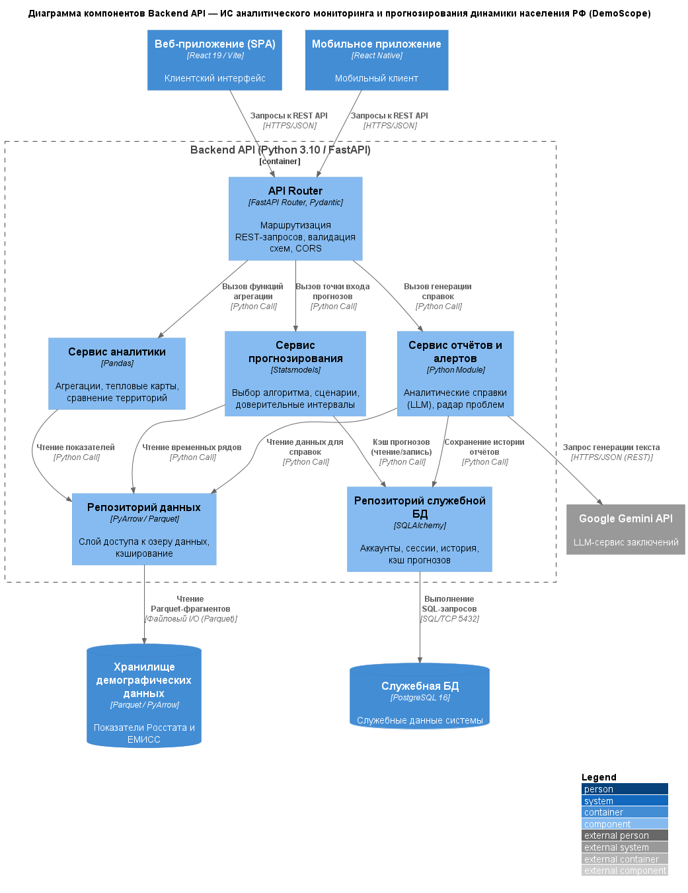

# Отчёт по лабораторной работе №2

**Дисциплина:** Информационные системы и технологии (ИСИТ, 3 семестр)
**Тема лабораторной работы:** C4 Model. Диаграмма компонентов (Level 3)
**Тема курсового проекта:** Разработка информационной системы аналитического мониторинга и прогнозирования динамики населения РФ
**Студент:** Бектеев Георгий, группа ИДБ-23-13 (Команда 18)
**Преподаватель:** Бычков Сергей Юрьевич

---

## 1. Цель работы

Получить практические навыки декомпозиции контейнера на внутренние логические элементы с использованием третьего уровня абстракции методологии C4 Model: научиться выделять компоненты ключевого контейнера бизнес-логики, фиксировать их ответственность и внутренние интерфейсы, демонстрировать разделение ответственности в соответствии с принципами многослойной архитектуры. Закрепить подход Diagrams-as-Code — описание архитектуры в текстовом формате PlantUML с библиотекой C4-PlantUML.

## 2. Постановка задачи

В соответствии с методическим пособием в рамках лабораторной работы №2 необходимо:

1. Разработать **диаграмму компонентов** (Component Diagram) для ключевого контейнера: выполнить декомпозицию контейнера бизнес-логики (бэкенда) на внутренние логические компоненты, выполняющиеся в едином адресном пространстве; диаграмма должна содержать не менее четырёх взаимосвязанных компонентов; продемонстрировать явное разделение ответственности между компонентами в соответствии с принципами многослойной архитектуры.
2. Подготовить текстовое обоснование принятых архитектурных решений и спецификацию внутренних интерфейсов компонентов.
3. Оформить отчёт по лабораторной работе.

## 3. Исходные данные. Ключевой контейнер Backend API

Объектом декомпозиции является контейнер `api_backend` (Backend API) системы DemoScope — платформы демографической аналитики, описанной в лабораторной работе №1. Контейнер реализован на стеке Python 3.10 / FastAPI с библиотеками Pandas, PyArrow и Statsmodels и исполняет ядро бизнес-логики системы:

- REST API мониторинга демографических показателей (численность населения, рождаемость, смертность, миграция, заработная плата), тепловых карт и сравнения территорий;
- прогнозирование динамики населения методами Хольта-Уинтерса, ARIMA и когортно-компонентным методом со сценарными поправками и доверительными интервалами;
- выявление проблемных территорий («радар проблем») на основе предиктивных алертов;
- генерация аналитических справок, в том числе с привлечением внешней большой языковой модели Google Gemini.

Backend API выбран в качестве ключевого контейнера обоснованно: именно в нём сосредоточена вся бизнес-логика системы, тогда как остальные контейнеры — клиентские приложения (`web_app`, `mobile_app`), хранилища (`data_store`, `db_service`) и конвейер подготовки данных (`data_pipeline`) — выполняют функции интерфейса, хранения и загрузки данных. В рамках распределения задач проектной команды №18 группы ИДБ-23-13 (Бектеев Г.А., Алибеков А., Лиджиев Э.С., Слисаренко Д., Сырлыбаев Б.С.) декомпозиция клиентского контейнера `web_app` параллельно выполняется фронтенд-разработчиком команды (Слисаренко Д.), а в настоящей работе детально рассматривается серверный контейнер `api_backend`. Внутри контейнера компоненты выполняются в едином адресном пространстве процесса и взаимодействуют прямыми программными вызовами (Python Call), без сетевых протоколов.

## 4. Диаграмма компонентов (Level 3)

Диаграмма компонентов выполняет «зум» внутрь контейнера `api_backend`: граница `Container_Boundary` объединяет внутренние логические компоненты, а внешние по отношению к бэкенду контейнеры (веб- и мобильное приложение, хранилища данных) и внешние системы вынесены за рамки границы. Внутри границы выделено шесть компонентов: маршрутизатор запросов, три сервиса бизнес-логики и два репозитория данных.

*Рисунок 1 — Диаграмма компонентов контейнера Backend API системы DemoScope*

### 4.1. Спецификация компонентов

| Компонент | ID | Технологии | Ответственность |
|---|---|---|---|
| API Router | `api_router` | FastAPI Router, Pydantic | Маршрутизация REST-запросов (`/api/population`, `/api/forecast`, `/api/report` и др.), валидация входных схем, CORS-политика |
| Сервис прогнозирования | `forecast_comp` | Statsmodels | Оркестрация прогнозов: выбор алгоритма (Хольт-Уинтерс, ARIMA, когортно-компонентный), применение сценарных поправок, расчёт доверительных интервалов |
| Сервис аналитики | `analytics_comp` | Pandas | Агрегация показателей, построение тепловых карт, сравнение территорий, расчёт топ-изменений |
| Сервис отчётов и алертов | `report_comp` | Python Module | Генерация аналитических справок (вызов LLM), формирование предиктивных алертов «радара проблем» |
| Репозиторий данных | `data_repo` | PyArrow / Parquet | Единый слой доступа к озеру данных: чтение временных рядов и агрегатов, предрасчёт и кэширование выборок |
| Репозиторий служебной БД | `db_repo` | SQLAlchemy | Доступ к служебной БД: учётные записи, сессии, история отчётов, кэш прогнозов |

## 5. Спецификация внутренних интерфейсов

Внутрипроцессное взаимодействие компонентов строится по принципу «слои через интерфейсы»: маршрутизатор обращается только к сервисам бизнес-логики, сервисы — только к репозиториям, репозитории — только к хранилищам. Ниже зафиксированы ключевые интерфейсы компонентов.

### 5.1. Внешний интерфейс (REST API маршрутизатора)

| Операция | Метод и путь | Назначение |
|---|---|---|
| Список территорий | `GET /api/regions`, `GET /api/municipalities` | Справочники субъектов и муниципалитетов |
| Показатели мониторинга | `GET /api/population`, `GET /api/demographics`, `GET /api/salary` | Временные ряды показателей по территориям |
| Аналитические выборки | `GET /api/top-changes`, `GET /api/heatmap`, `GET /api/compare/territories` | Топ-изменения, тепловая карта, сравнение территорий |
| Прогнозирование | `POST /api/forecast` | Прогноз динамики населения по выбранному алгоритму и сценарию |
| Отчёты и алерты | `POST /api/report`, `GET /api/predictive-alerts`, `POST /api/llm-analysis` | Аналитические справки, «радар проблем», LLM-анализ |

### 5.2. Внутренние программные интерфейсы (Python Call)

| Компонент-владелец | Интерфейс (сигнатура) | Вызывающие компоненты |
|---|---|---|
| `forecast_comp` | `run_forecast(years, values, horizon, model_type, scenario, cohort_data) -> dict` | `api_router` |
| `analytics_comp` | `get_heatmap_data()`, `get_compare_territories(region, years)`, `get_top_changes(limit, years)` | `api_router` |
| `report_comp` | `generate_report(region, indicators) -> Report`, `get_predictive_alerts() -> list[Alert]` | `api_router` |
| `data_repo` | `get_population_data(region, years)`, `get_population_timeseries(region)`, `load_births()`, `load_deaths()` | `forecast_comp`, `analytics_comp`, `report_comp` |
| `db_repo` | `get_forecast_cache(key)`, `save_forecast_cache(key, payload)`, `save_report_history(report)` | `forecast_comp`, `report_comp` |

Формулировки сигнатур фиксируют **целевые проектные контракты** компонента (подход as-is/to-be, принятый в лабораторной работе №1): названия и состав операций сверены с действующей кодовой базой проекта, однако часть контрактов (в частности, доступ к кэшу прогнозов и истории отчётов через `db_repo`, а также сценарные поправки в `run_forecast`) реализуется по мере развития проекта в спринтах.

### 5.3. Спецификация связей

| Инициатор | Получатель | Передаваемые данные / бизнес-действие | Протокол |
|---|---|---|---|
| Веб-приложение (SPA) | `api_router` | Запросы к REST API | HTTPS/JSON |
| Мобильное приложение | `api_router` | Запросы к REST API | HTTPS/JSON |
| `api_router` | `analytics_comp` | Вызов функций агрегации | Python Call |
| `api_router` | `forecast_comp` | Вызов точки входа прогнозов | Python Call |
| `api_router` | `report_comp` | Вызов генерации справок | Python Call |
| `forecast_comp` | `data_repo` | Чтение временных рядов | Python Call |
| `analytics_comp` | `data_repo` | Чтение показателей | Python Call |
| `report_comp` | `data_repo` | Чтение данных для справок | Python Call |
| `forecast_comp` | `db_repo` | Кэш прогнозов (чтение/запись) | Python Call |
| `report_comp` | `db_repo` | Сохранение истории отчётов | Python Call |
| `data_repo` | Хранилище демографических данных | Чтение Parquet-фрагментов | Файловый I/O (Parquet) |
| `db_repo` | Служебная БД | Выполнение SQL-запросов | SQL/TCP 5432 |
| `report_comp` | Google Gemini API | Запрос генерации текста | HTTPS/JSON (REST) |

Стрелки между внутренними компонентами — прямые программные вызовы в общем адресном пространстве. Изнутри контейнера наружу ведут только стрелки от репозиториев к хранилищам и от сервиса отчётов к внешнему LLM-сервису; входящие сетевые стрелки — запросы клиентских приложений к маршрутизатору.

## 6. Обоснование архитектурных решений

1. **Многослойная архитектура.** Компоненты сгруппированы в три слоя: слой представления (`api_router`), слой бизнес-логики (`forecast_comp`, `analytics_comp`, `report_comp`) и слой доступа к данным (`data_repo`, `db_repo`). Зависимости направлены строго вниз: маршрутизатор не обращается к хранилищам напрямую, а сервисы не знают о транспортном уровне. Такая структура изолирует замену любых горизонталей — например, смена FastAPI на другой фреймворк не затрагивает бизнес-логику.
2. **Выделение единого слоя доступа к данным.** Всё чтение демографических массивов инкапсулировано в `data_repo`: сервисы работают с рядами и агрегатами, не зная деталей физического формата (Parquet) и схемы разбиения файлов озера данных. Это соответствует принципу инверсии зависимостей — бизнес-слой зависит от интерфейса репозитория, а не от технологии хранения.
3. **Разделение аналитической и служебной нагрузки.** Прогнозирование, аналитика и отчёты выделены в три независимых сервиса бизнес-логики: у каждого своя зона ответственности и собственные источники данных. Кэш прогнозов и история отчётов обслуживаются отдельным репозиторием `db_repo` с транзакционной СУБД, что отделяет служебную нагрузку от больших аналитических выборок.
4. **Единая точка входа прогнозирования.** Сервис прогнозирования предоставляет один интерфейс `run_forecast` с параметром выбора алгоритма: маршрутизатор не знает о трёх методах прогнозирования, их перебор и сценарные поправки инкапсулированы внутри компонента (детализация на уровне классов выполнена в лабораторной работе №3).
5. **Внешние интеграции за границей контейнера.** Генерация текста справок выполняется внешним сервисом Google Gemini: компонент `report_comp` обращается к нему по HTTPS/JSON, что отражено на диаграмме выносом LLM-сервиса за границу `Container_Boundary`.

## 7. Глоссарий идентификаторов (Glossary IDs)

К идентификаторам уровней L1/L2 (см. лабораторную работу №1) добавлены идентификаторы компонентов:

| ID | Элемент | Тип |
|---|---|---|
| `api_router` | API Router (маршрутизатор) | Компонент |
| `forecast_comp` | Сервис прогнозирования | Компонент |
| `analytics_comp` | Сервис аналитики | Компонент |
| `report_comp` | Сервис отчётов и алертов | Компонент |
| `data_repo` | Репозиторий данных (озеро данных) | Компонент |
| `db_repo` | Репозиторий служебной БД | Компонент |
| `web_app`, `mobile_app`, `data_store`, `db_service`, `gemini_api` | Внешние по отношению к бэкенду элементы | Контейнеры / внешние системы (см. ЛР1) |

## 8. Соответствие требованиям методического пособия

| Требование | Выполнение |
|---|---|
| Декомпозиция ключевого контейнера бизнес-логики на внутренние компоненты | Выполнено: контейнер `api_backend` декомпозирован на 6 компонентов |
| Не менее 4 взаимосвязанных компонентов в едином адресном пространстве | Выполнено: 6 компонентов, взаимодействие — прямые программные вызовы |
| Явное разделение ответственности (многослойная архитектура) | Выполнено: 3 слоя — представление, бизнес-логика, доступ к данным (п. 6) |
| Текстовое обоснование архитектурных решений | Выполнено: п. 6, пять обоснований |
| Спецификация внутренних интерфейсов | Выполнено: п. 5.1 (REST), п. 5.2 (программные интерфейсы), п. 5.3 (связи) |
| Протоколы на всех внешних связях компонента | Выполнено: HTTPS/JSON, SQL/TCP 5432, файловый I/O, HTTPS/JSON (REST) |
| Инструмент — PlantUML + C4-PlantUML | Выполнено: макросы `Component`, `Container_Boundary`, `Container`, `ContainerDb`, `System_Ext`, `Rel`, `LAYOUT_WITH_LEGEND` |
| Запреты: только `Rel()`, без `skinparam` | Выполнено: нарушений нет |

## 9. Выводы

В ходе лабораторной работы освоен третий уровень абстракции модели C4 применительно к теме курсового проекта. Ключевой контейнер системы DemoScope — Backend API — декомпозирован на шесть внутренних компонентов, сгруппированных в три слоя: маршрутизатор запросов, три сервиса бизнес-логики (прогнозирование, аналитика, отчёты и алерты) и два репозитория данных. Зафиксированы ответственность каждого компонента и его внутренние интерфейсы: внешний REST API, программные интерфейсы сервисов и репозиториев, протоколы всех внешних связей. Диаграмма построена в нотации C4-PlantUML в подходе Diagrams-as-Code. Выделение слоя доступа к данным и единой точки входа прогнозирования подготовило основу для следующего уровня детализации — проектирования классов прогнозного компонента с паттерном «Стратегия» (лабораторная работа №3).
