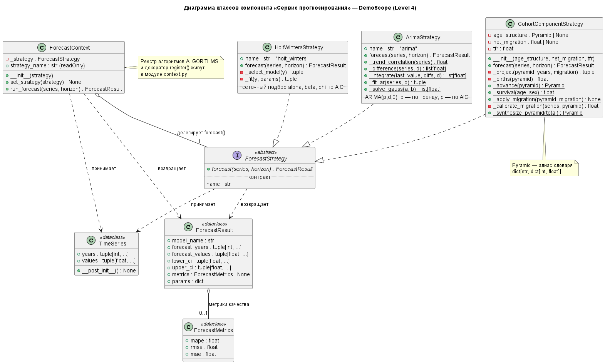

# Отчёт по лабораторной работе №3

**Дисциплина:** Информационные системы и технологии (ИСИТ, 3 семестр)
**Тема лабораторной работы:** C4 Model. Диаграмма кода (Level 4)
**Тема курсового проекта:** Разработка информационной системы аналитического мониторинга и прогнозирования динамики населения РФ
**Студент:** Бектеев Георгий, группа ИДБ-23-13 (Команда 18)
**Преподаватель:** Бычков Сергей Юрьевич

---

## 1. Цель работы

Получить практические навыки детализации архитектуры на уровне кода: научиться отображать объектно-ориентированную структуру архитектурного компонента в виде диаграммы классов UML с интерфейсами, атрибутами, методами и типами связей, а также реализовывать спроектированную структуру в виде чистого объектно-ориентированного кода на Python с обязательным применением шаблона проектирования «Стратегия» (Strategy), строгой аннотацией типов (Type Hinting) и соблюдением принципов SOLID.

## 2. Постановка задачи

В соответствии с методическим пособием в рамках лабораторной работы №3 необходимо:

1. Разработать **диаграмму классов UML** (UML Class Diagram) для выбранного компонента: отобразить структуру классов, интерфейсов и типов объектно-ориентированных связей (реализация, композиция, зависимость).
2. Реализовать **прототип компонента на Python**: чистый объектно-ориентированный код с обязательным использованием шаблона «Стратегия» для динамической подмены алгоритмов бизнес-логики, снабжённый строгой аннотацией типов и соответствующий принципам SOLID.
3. Выполнить прототип и зафиксировать результаты его работы.
4. Оформить отчёт по лабораторной работе.

## 3. Исходные данные. Компонент «Сервис прогнозирования»

Объектом проектирования является компонент «Сервис прогнозирования» (`forecast_comp`), выделенный в составе контейнера Backend API на диаграмме компонентов (лабораторная работа №2). Компонент выполняет оркестрацию прогнозирования динамики населения тремя алгоритмами: двойное экспоненциальное сглаживание (Хольт-Уинтерс), ARIMA и когортно-компонентный метод; для статистических моделей формируются доверительные интервалы и метрики аппроксимации (MAPE, RMSE, MAE), для когортно-компонентного метода — метрики аппроксимации по бэктесту.

Ключевое архитектурное требование к компоненту — **динамическая подмена алгоритма прогнозирования без изменения клиентского кода**: маршрутизатор REST API выбирает алгоритм параметром запроса, и добавление нового метода прогнозирования не должно затрагивать ни контекст выполнения, ни существующие реализации. Это требование напрямую диктует применение шаблона «Стратегия» и соответствует принципу открытости/закрытости (Open/Closed Principle) из SOLID.

**Границы прототипа.** Прототип сфокусирован на паттерне «Стратегия» и воспроизводит ядро компонента — выбор алгоритма и расчёт прогноза. Функциональность боевого контракта `run_forecast` из лабораторной работы №2, не относящаяся к подмене алгоритмов (сценарные поправки к ряду, работа с кэшем прогнозов через `db_repo`, приём когортных данных из `cohort_data`), остаётся в сервисном слое компонента и в прототип не включена: замена `model_type` на динамическую подмену стратегии — предмет именно этой лабораторной работы.

## 4. Диаграмма классов (Level 4)

Диаграмма классов отображает объектно-ориентированную структуру компонента. Абстрактный интерфейс `ForecastStrategy` фиксирует единый контракт метода `forecast()`; три конкретные стратегии реализуют контракт (пунктирные стрелки с незакрашенным треугольником — отношение реализации); контекст `ForecastContext` владеет ссылкой на стратегию (ромб — агрегация «1 к 1») и делегирует ей расчёт. Контракты данных (`TimeSeries`, `ForecastResult`, `ForecastMetrics`) оформлены неизменяемыми data-классами.



*Рисунок 1 — Диаграмма классов компонента «Сервис прогнозирования»*

### 4.1. Спецификация классов

| Класс | Категория | Ответственность |
|---|---|---|
| `ForecastStrategy` | Абстрактный интерфейс | Единый контракт прогнозирования: метод `forecast(series, horizon)` для всех алгоритмов |
| `HoltWintersStrategy` | Конкретная стратегия | Двойное экспоненциальное сглаживание; сеточный подбор alpha, beta, phi по критерию AIC |
| `ArimaStrategy` | Конкретная стратегия | ARIMA(p, d, 0): порядок d — по выраженности тренда, порядок p — сеточный поиск по AIC |
| `CohortComponentStrategy` | Конкретная стратегия | Когортно-компонентный метод: продвижение пирамиды населения с учётом рождаемости, смертности и миграции |
| `ForecastContext` | Контекст | Хранение активной стратегии, динамическая подмена (`set_strategy`), единая точка входа `run_forecast` |
| `TimeSeries` | Контракт данных | Неизменяемый исторический ряд (годы и значения) |
| `ForecastResult` | Контракт данных | Единая структура результата: прогноз, доверительные интервалы, метрики, параметры модели |
| `ForecastMetrics` | Контракт данных | Метрики качества аппроксимации (MAPE, RMSE, MAE) |

## 5. Реализация прототипа на Python

### 5.1. Структура модуля

Прототип размещён в пакете `forecasting`; он воспроизводит набор алгоритмов и контракты боевого модуля проекта. Реализация выполнена на чистой стандартной библиотеке Python (без внешних зависимостей), что позволяет запускать прототип в любом окружении.

```
лаб3/src/
├── demo.py                     # демонстрация: подмена стратегий в runtime
└── forecasting/
    ├── __init__.py             # публичный API пакета
    ├── models.py               # контракты данных (dataclasses)
    ├── metrics.py              # метрики качества (mape, rmse, mae)
    ├── base.py                 # абстрактный контракт стратегии (ABC)
    ├── holt_winters.py         # стратегия Хольта-Уинтерса
    ├── arima.py                # стратегия ARIMA(p,d,0)
    ├── cohort_component.py     # когортно-компонентная стратегия
    └── context.py              # контекст + реестр алгоритмов
```

### 5.2. Ключевые листинги

Абстрактный контракт стратегии (base.py) — единая точка расширяемости компонента:

```python
class ForecastStrategy(ABC):
    """Интерфейс стратегии прогнозирования динамики населения."""

    name: str = "strategy"

    @abstractmethod
    def forecast(self, series: TimeSeries,
                 horizon: int = 10) -> ForecastResult:
        """Строит прогноз на horizon лет по историческому ряду."""
        raise NotImplementedError
```

Контекст с динамической подменой стратегии (context.py) — свойство `strategy_name` даёт клиенту имя активного алгоритма:

```python
class ForecastContext:
    """Контекст: делегирует расчёт прогноза активной стратегии."""

    def __init__(self, strategy: ForecastStrategy) -> None:
        self._strategy = strategy

    @property
    def strategy_name(self) -> str:
        """Имя активного алгоритма (для логирования и UI)."""
        return self._strategy.name

    def set_strategy(self, strategy: ForecastStrategy) -> None:
        """Динамическая подмена алгоритма во время выполнения."""
        self._strategy = strategy

    def run_forecast(self, series: TimeSeries,
                     horizon: int = 10) -> ForecastResult:
        """Единая точка входа: расчёт прогноза активной стратегией."""
        return self._strategy.forecast(series, horizon)
```

Ядро алгоритма Хольта-Уинтерса (holt_winters.py) — рекуррентные уравнения сглаживания с демпфированием тренда:

```python
def _fit(self, y: list[float],
         params: Params) -> tuple[list[float], float, float, float | None]:
    """Проход рекуррентных уравнений Хольта по ряду."""
    alpha, beta, phi = (float(params["alpha"]),
                        float(params["beta"]), float(params["phi"]))
    multiplicative = params["trend"] == "mul"
    level = y[0]
    trend = ((y[1] - y[0]) / y[0]
             if (multiplicative and y[0] != 0) else (y[1] - y[0]))
    fitted: list[float] = [level]
    sse = 0.0
    for t in range(1, len(y)):
        forecast_point = (level * (1.0 + phi * trend)
                          if multiplicative else level + phi * trend)
        error = y[t] - forecast_point
        sse += error ** 2
        if multiplicative and level != 0:
            new_level = alpha * y[t] + (1 - alpha) * level * (1.0 + phi * trend)
            new_trend = (beta * (new_level / level - 1.0)
                         + (1 - beta) * phi * trend)
        else:
            new_level = alpha * y[t] + (1 - alpha) * (level + phi * trend)
            new_trend = beta * (new_level - level) + (1 - beta) * phi * trend
        level, trend = new_level, new_trend
        fitted.append(forecast_point)
    return fitted, level, trend, sse
```

### 5.3. Соответствие принципам SOLID

| Принцип | Как соблюдается |
|---|---|
| S — Single Responsibility | Каждый класс отвечает за одну задачу: стратегии — только расчёт прогноза, контекст — только выбор и делегирование, models — только контракты данных, metrics — только расчёт метрик |
| O — Open/Closed | Новый алгоритм добавляется классом-наследником `ForecastStrategy` и регистрацией в реестре; контекст и клиентский код не изменяются |
| L — Liskov Substitution | Все стратегии взаимозаменяемы: любая принимает `TimeSeries` и возвращает `ForecastResult`, что подтверждено демонстрацией подмены в runtime |
| I — Interface Segregation | Интерфейс стратегии содержит единственный метод `forecast` — клиенты не зависят от методов, которые не используют |
| D — Dependency Inversion | Контекст зависит от абстракции `ForecastStrategy`, а не от конкретных алгоритмов; конкретные стратегии внедряются в конструктор |

Требование **Type Hinting** выполнено полностью: сигнатуры всех публичных и приватных методов аннотированы (включая `list[float]`, `tuple[int, ...]`, `dict[str, str | int | float]`, `ForecastMetrics | None`), данные оформлены frozen-data-классами.

## 6. Результаты выполнения прототипа

Прототип выполнен командой `python demo.py`. Демонстрационный сценарий прогоняет один и тот же ряд (численность населения депопулирующего региона, 2010–2025, тыс. чел.) через единый контекст; стратегии берутся из реестра `ALGORITHMS`, поэтому подключение нового алгоритма не потребует изменения клиентского кода:

```
==============================================================================
DemoScope: прогноз численности населения региона на 5 лет
Исторический ряд: 2010-2025 (1553.9 -> 1437.0 тыс. чел.)
==============================================================================

Алгоритм: Хольт-Уинтерс (двойное экспоненциальное сглаживание) [holt_winters]
  Параметры: {'trend': 'mul', 'damped': False, 'alpha': 0.8, 'beta': 0.5, 'phi': 1.0, 'aic': 42.3}
  Метрики аппроксимации: MAPE=0.18% RMSE=3.21 MAE=2.75
  Прогноз (тыс. чел.):
    2026:   1428.5   (95% ДИ:   1422.2 ..   1434.8)
    2027:   1420.3   (95% ДИ:   1411.4 ..   1429.2)
    2028:   1412.0   (95% ДИ:   1401.1 ..   1422.9)
    2029:   1403.8   (95% ДИ:   1391.2 ..   1416.4)
    2030:   1395.5   (95% ДИ:   1381.4 ..   1409.6)

Алгоритм: ARIMA(2,1,0) [arima]
  Параметры: {'p': 2, 'd': 1, 'q': 0, 'aic': 2.3}
  Метрики аппроксимации: MAPE=0.05% RMSE=1.08 MAE=0.72
  Прогноз (тыс. чел.):
    2026:   1428.6   (95% ДИ:   1426.7 ..   1430.4)
    2027:   1419.8   (95% ДИ:   1417.2 ..   1422.4)
    2028:   1410.8   (95% ДИ:   1407.5 ..   1414.0)
    2029:   1401.6   (95% ДИ:   1397.9 ..   1405.3)
    2030:   1392.4   (95% ДИ:   1388.2 ..   1396.5)

Алгоритм: Когортно-компонентный метод [cohort]
  Параметры: {'шаг модели': '1 год', 'СКР': 1.5, 'миграция, тыс./год': -2.78}
  Метрики аппроксимации: MAPE=0.53% RMSE=9.37 MAE=7.93
  Прогноз (тыс. чел.):
    2026:   1423.4
    2027:   1414.1
    2028:   1404.5
    2029:   1394.7
    2030:   1384.7

==============================================================================
Проверка SOLID: контекст принял 3 стратегий(и) из реестра
ALGORITHMS без изменения клиентского кода — принцип Open/Closed выполнен.
==============================================================================
```

Интерпретация результатов:

1. **Хольт-Уинтерс и ARIMA** дают согласованную траекторию (около −8…−9 тыс. чел. в год) с малой ошибкой аппроксимации; модель Хольта-Уинтерса выбрала мультипликативный тренд (AIC=42.3, MAPE=0.18%), а ARIMA автоматически выбрала порядок интегрирования d=1 (выраженный линейный тренд) и порядок p=2 по критерию AIC (MAPE=0.05%).
2. **Когортно-компонентный метод** показывает высокую точность бэктеста (MAPE=0.53%) и прогнозирует несколько более крутую убыль (−9,3…−10,0 тыс. чел. в год): модель «старит» пирамиду населения, и доля пожилых когорт с высокой смертностью растёт — это демографически корректный эффект инерции, невидимый для статистических моделей по итоговому ряду. Доверительные интервалы для когортной модели не строятся: при фиксированных коэффициентах результат детерминирован, качество оценивается бэктестом.
3. Все три результата объединены единым контрактом `ForecastResult`: маршрутизатор REST API получает одинаковую структуру независимо от выбранного алгоритма, что подтверждает работоспособность паттерна «Стратегия».

## 7. Глоссарий идентификаторов (Glossary IDs)

К идентификаторам уровней L1–L3 добавлены идентификаторы классов прототипа:

| ID | Элемент | Тип |
|---|---|---|
| `ForecastStrategy` | Интерфейс стратегии прогнозирования | Абстракция (ABC) |
| `HoltWintersStrategy` | Стратегия Хольта-Уинтерса | Конкретная стратегия |
| `ArimaStrategy` | Стратегия ARIMA(p,d,0) | Конкретная стратегия |
| `CohortComponentStrategy` | Когортно-компонентная стратегия | Конкретная стратегия |
| `ForecastContext` | Контекст прогнозирования | Контекст (паттерн) |
| `TimeSeries`, `ForecastResult`, `ForecastMetrics` | Контракты данных | Frozen dataclass |

## 8. Соответствие требованиям методического пособия

| Требование | Выполнение |
|---|---|
| Диаграмма классов UML для выбранного компонента | Выполнено: 8 классов с атрибутами, методами и типами связей (п. 4) |
| Объектно-ориентированная структура: классы, интерфейсы, типы связей | Выполнено: реализация (`..|>`), агрегация (`o--`), зависимости (`..>`) |
| Обязательный паттерн «Стратегия» | Выполнено: интерфейс + 3 конкретные стратегии + контекст с подменой в runtime |
| Чистый ООП-код на Python | Выполнено: пакет `forecasting` из 8 модулей, data-классы, ABC |
| Строгая аннотация типов (Type Hinting) | Выполнено: все сигнатуры аннотированы, включая обобщённые типы и объединения |
| Соответствие принципам SOLID | Выполнено: таблица соответствия в п. 5.3 |
| Прототип выполнен, результаты зафиксированы | Выполнено: листинг вывода в п. 6 |
| Инструмент — PlantUML | Выполнено: диаграмма классов описана текстом в PlantUML (Diagrams-as-Code) |

## 9. Выводы

В ходе лабораторной работы освоен четвёртый уровень абстракции модели C4 применительно к теме курсового проекта. Спроектирована диаграмма классов компонента «Сервис прогнозирования», зафиксировавшая объектно-ориентированную структуру: абстрактный контракт `ForecastStrategy`, три конкретные стратегии (Хольт-Уинтерс, ARIMA, когортно-компонентный метод), контекст с динамической подменой и неизменяемые контракты данных. Структура реализована в виде чистого объектно-ориентированного прототипа на Python с полной аннотацией типов и соблюдением всех пяти принципов SOLID; работоспособность подтверждена выполнением демонстрации, в которой один и тот же контекст последовательно принял три алгоритма без изменения клиентского кода. Полученный прототип воспроизводит логику боевого модуля проекта и образует основу для интеграции архитектурного описания в единый репозиторий (лабораторная работа №5).
