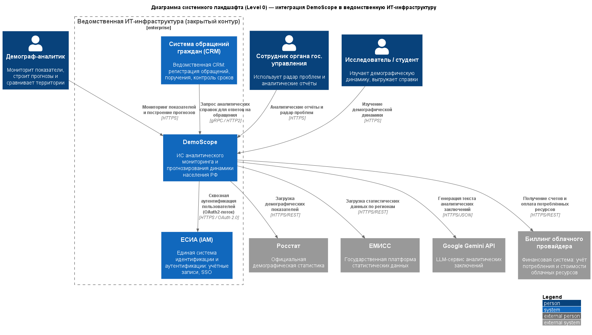
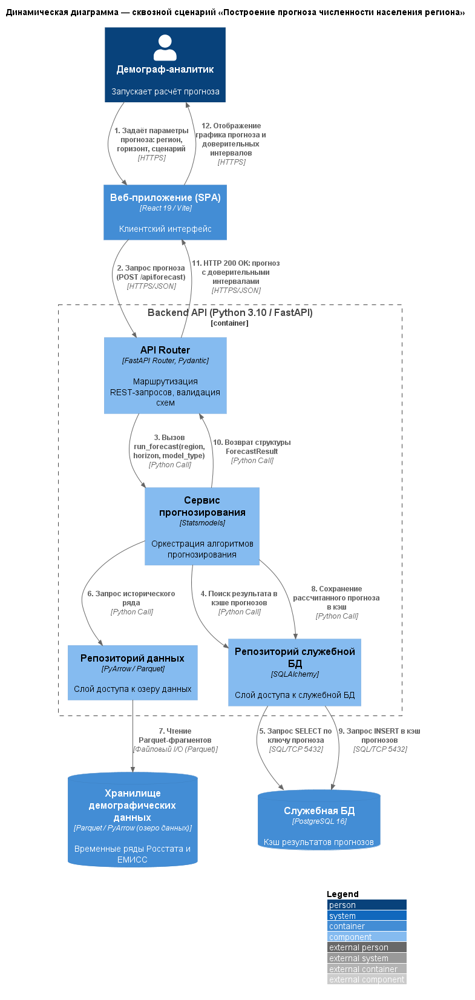
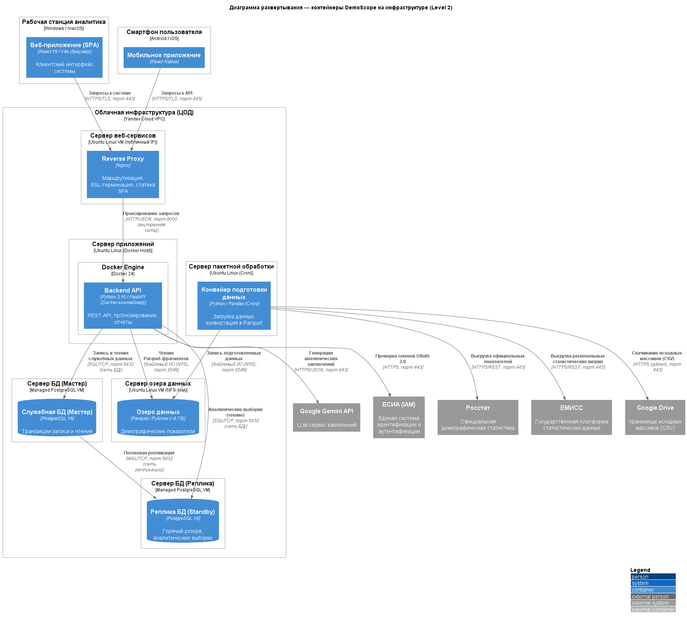

# Отчёт по лабораторной работе №4

**Дисциплина:** Информационные системы и технологии (ИСИТ, 3 семестр)
**Тема лабораторной работы:** C4 Model. Макроархитектура, динамические процессы и инфраструктура развертывания
**Тема курсового проекта:** Разработка информационной системы аналитического мониторинга и прогнозирования динамики населения РФ
**Студент:** Бектеев Георгий, группа ИДБ-23-13 (Команда 18)
**Преподаватель:** Бычков Сергей Юрьевич

---

## 1. Цель работы

Получить практические навыки моделирования макроуровня архитектуры и рантайм-поведения системы: научиться отображать интеграцию продукта в корпоративную ИТ-инфраструктуру на диаграмме системного ландшафта (Level 0), фиксировать хронологию сквозного процесса на динамической диаграмме с последовательной нумерацией вызовов, а также проектировать физическую инфраструктуру развертывания контейнеров с указанием узлов, сетевых протоколов, портов и топологии отказоустойчивости.

## 2. Постановка задачи

В соответствии с методическим пособием в рамках лабораторной работы №4 необходимо:

1. Разработать **диаграмму системного ландшафта** (Level 0), отображающую встраивание системы в ИТ-инфраструктуру предметной области с выделением внешних ИТ-границ; отразить взаимодействие целевой системы как минимум с двумя смежными корпоративными системами и одной внешней финансовой системой с обязательным указанием протоколов (gRPC, HTTPS, OAuth2).
2. Разработать **динамическую диаграмму** (Dynamic Diagram) для сквозного процесса взаимодействия: модель рантайм-сценария с хронологическим порядком вызовов, зафиксированным последовательной нумерацией.
3. Разработать **диаграмму развертывания** для уровня контейнеров: физическая/виртуальная инфраструктура, логические узлы и контейнеры сред выполнения, параметры сетевой безопасности (порты, шифрование TLS, протоколы), топология распределения и отказоустойчивости (репликация БД, обратный прокси).
4. Оформить отчёт по лабораторной работе.

## 3. Исходные данные

Объектом моделирования является система DemoScope (см. лабораторные работы №1–3): платформа демографической аналитики на стеке Python/FastAPI и React, состоящая из шести контейнеров (веб- и мобильное приложение, Backend API, конвейер подготовки данных, озеро данных Parquet, служебная БД PostgreSQL 16). На уровнях L1–L3 описан статический срез архитектуры; в настоящей работе система рассматривается в трёх новых разрезах: макроландшафт ведомственной ИТ-инфраструктуры, рантайм-хронология ключевого процесса и физическое размещение контейнеров.

Развертывание описывается для целевой конфигурации в облачной инфраструктуре (Yandex Cloud); мобильное приложение включено в контур на общих основаниях (проект находится на этапе архитектурного проектирования, реализация ведётся по спринтам).

## 4. Диаграмма системного ландшафта (Level 0)

Диаграмма ландшафта показывает встраивание DemoScope в ведомственную ИТ-инфраструктуру и взаимодействие с пользовательскими ролями. Граница `Enterprise_Boundary` очерчивает закрытый корпоративный контур, внутри которого находятся проектируемая система и две смежные корпоративные платформы: ЕСИА (IAM — единая система идентификации) и ведомственная CRM обращений граждан. За пределами контура — три пользовательские роли, внешние источники статистики, LLM-сервис и финансовая система биллинга облачного провайдера.

*Рисунок 1 — Диаграмма системного ландшафта DemoScope (Level 0)*

### 4.1. Спецификация элементов

| Элемент | Тип | Расположение | Назначение |
|---|---|---|---|
| Демограф-аналитик | Person | Вне контура | Основной пользователь: мониторит показатели, строит прогнозы и сравнивает территории |
| Сотрудник органа гос. управления | Person | Вне контура | Использует «радар проблем» и аналитические отчёты для принятия управленческих решений |
| Исследователь / студент | Person | Вне контура | Изучает демографическую динамику, выгружает аналитические справки |
| DemoScope | Software System | Внутри корпоративного контура | Проектируемая система мониторинга и прогнозирования |
| ЕСИА (IAM) | Corporate System | Внутри корпоративного контура | Единая система идентификации и аутентификации: SSO, учётные записи |
| Система обращений граждан (CRM) | Corporate System | Внутри корпоративного контура | Регистрация обращений, поручения, контроль сроков |
| Росстат | External System | Вне контура | Официальная демографическая статистика |
| ЕМИСС | External System | Вне контура | Государственная платформа статистических данных |
| Google Gemini API | External System | Вне контура | LLM-сервис аналитических заключений |
| Биллинг облачного провайдера | External System (финансовая) | Вне контура | Учёт потребления и стоимости облачных ресурсов |

### 4.2. Спецификация связей

| Инициатор | Получатель | Назначение | Протокол |
|---|---|---|---|
| Демограф-аналитик | DemoScope | Мониторинг показателей и построение прогнозов | HTTPS |
| Сотрудник органа гос. управления | DemoScope | Аналитические отчёты и радар проблем | HTTPS |
| Исследователь / студент | DemoScope | Изучение демографической динамики | HTTPS |
| DemoScope | ЕСИА (IAM) | Сквозная аутентификация пользователей (OAuth2-поток) | HTTPS / OAuth 2.0 |
| CRM | DemoScope | Запрос аналитических справок для ответов на обращения | gRPC / HTTP2 |
| DemoScope | Росстат | Загрузка демографических показателей | HTTPS/REST |
| DemoScope | ЕМИСС | Загрузка статистических данных по регионам | HTTPS/REST |
| DemoScope | Google Gemini API | Генерация текста аналитических заключений | HTTPS/JSON |
| DemoScope | Биллинг облачного провайдера | Получение счетов и оплата потреблённых ресурсов | HTTPS/REST |

Взаимодействие внутри закрытого контура выполняется по защищённым межсистемным каналам (OAuth 2.0, gRPC). Доступ во внешние сети выполняется только исходящими HTTPS-соединениями из приватного сегмента через контролируемый egress-шлюз с белым списком адресов; публикуемых наружу сервисов у системы нет — входящий трафик ограничен порталом системы (см. п. 6.3).

## 5. Динамическая диаграмма

В качестве сквозного рантайм-процесса выбран ключевой бизнес-сценарий системы — **«Построение прогноза численности населения региона»**. Диаграмма фиксирует хронологический порядок вызовов последовательной нумерацией от 1 до 12: от постановки задачи аналитиком до отображения результата с доверительными интервалами. Вход в контейнер `api_backend` осуществляется через маршрутизатор `api_router`, а доступ к озеру данных выполняется строго через компонент «Репозиторий данных» (`data_repo`) в полном соответствии с трёхслойной архитектурой Backend API (лабораторная работа №2).

*Рисунок 2 — Динамическая диаграмма: сценарий построения прогноза*

### 5.1. Спецификация шагов

| Шаг | Инициатор | Получатель | Действие | Протокол |
|---|---|---|---|---|
| 1 | Демограф-аналитик | Веб-приложение | Задаёт параметры прогноза: регион, горизонт, сценарий | HTTPS |
| 2 | Веб-приложение | API Router | Запрос прогноза (`POST /api/forecast`) | HTTPS/JSON |
| 3 | API Router | Сервис прогнозирования | Вызов `run_forecast(region, horizon, model_type)` | Python Call |
| 4 | Сервис прогнозирования | Репозиторий служебной БД | Поиск результата в кэше прогнозов | Python Call |
| 5 | Репозиторий служебной БД | Служебная БД | Запрос `SELECT` по ключу прогноза | SQL/TCP 5432 |
| 6 | Сервис прогнозирования | Репозиторий данных | Запрос исторического ряда | Python Call |
| 7 | Репозиторий данных | Озеро данных | Чтение Parquet-фрагментов | Файловый I/O (Parquet) |
| 8 | Сервис прогнозирования | Репозиторий служебной БД | Сохранение рассчитанного прогноза в кэш | Python Call |
| 9 | Репозиторий служебной БД | Служебная БД | Запрос `INSERT` в кэш прогнозов | SQL/TCP 5432 |
| 10 | Сервис прогнозирования | API Router | Возврат структуры `ForecastResult` | Python Call |
| 11 | API Router | Веб-приложение | `HTTP 200 OK`: прогноз с доверительными интервалами | HTTPS/JSON |
| 12 | Веб-приложение | Демограф-аналитик | Отображение графика прогноза и доверительных интервалов | HTTPS |

Шаги 4–5 реализуют проверку кэша до тяжёлого расчёта: при попадании в кэш повторный запрос того же прогноза обслуживается из СУБД, а шаги 6–9 (чтение озера данных и сохранение результата) пропускаются — это снижает время отклика и нагрузку на хранилище.

## 6. Диаграмма развертывания

Диаграмма развертывания отображает физическую инфраструктуру, на которую разворачиваются контейнеры системы: клиентские узлы (рабочая станция, смартфон), облачная инфраструктура Yandex Cloud с узлами веб-сервисов, приложений (Docker), пакетной обработки, озера данных и кластера PostgreSQL, а также внешние системы.

*Рисунок 3 — Диаграмма развертывания DemoScope*

### 6.1. Узлы и размещённые контейнеры

| Узел | Тип | Контейнеры |
|---|---|---|
| Рабочая станция аналитика | Windows / macOS | Веб-приложение (SPA React 19, браузер) |
| Смартфон пользователя | Android / iOS | Мобильное приложение (React Native) |
| Сервер веб-сервисов | Ubuntu Linux VM (публичный IP) | Reverse Proxy (Nginx): маршрутизация, SSL-терминация, статика SPA |
| Сервер приложений | Ubuntu Linux (Docker Host) | Docker Engine 24 → Backend API (Python 3.10 / FastAPI) |
| Сервер пакетной обработки | Ubuntu Linux (Cron) | Конвейер подготовки данных (Python / Pandas) |
| Сервер озера данных | Ubuntu Linux VM (NFS-том) | Озеро данных (Parquet / PyArrow, ~6 ГБ) |
| Сервер БД (Мастер) | Managed PostgreSQL VM | Служебная БД (PostgreSQL 16) — все транзакции записи |
| Сервер БД (Реплика) | Managed PostgreSQL VM | Реплика БД (PostgreSQL 16) — горячий резерв |

### 6.2. Сетевые взаимодействия

| Исходный элемент | Целевой элемент | Описание взаимодействия | Протокол и порт | Сетевая среда |
|---|---|---|---|---|
| Веб-приложение (SPA) | Reverse Proxy | Запросы к системе | HTTPS/TLS, порт 443 | Открытая сеть (Internet) |
| Мобильное приложение | Reverse Proxy | Запросы к API | HTTPS/TLS, порт 443 | Открытая сеть (Internet) |
| Reverse Proxy | Backend API | Проксирование запросов | HTTP/JSON, порт 8000 | Внутренняя сеть ЦОД |
| Backend API | Служебная БД (Мастер) | Запись и чтение служебных данных | SQL/TCP, порт 5432 | Сеть БД (выделенная подсеть) |
| Служебная БД (Мастер) | Реплика БД | Потоковая репликация | WAL/TCP, порт 5432 | Изолированная сеть репликации |
| Backend API | Служебная БД (Реплика) | Аналитические выборки (чтение) | SQL/TCP, порт 5432 | Сеть БД (выделенная подсеть) |
| Backend API | Озеро данных | Чтение Parquet-фрагментов | Файловый I/O (NFS), порт 2049 | Внутренняя сеть ЦОД |
| Конвейер подготовки данных | Озеро данных | Запись подготовленных данных | Файловый I/O (NFS), порт 2049 | Внутренняя сеть ЦОД |
| Конвейер подготовки данных | Росстат | Выгрузка официальных показателей | HTTPS/REST, порт 443 | Открытая сеть (Internet) |
| Конвейер подготовки данных | ЕМИСС | Выгрузка региональных статистических витрин | HTTPS/REST, порт 443 | Открытая сеть (Internet) |
| Конвейер подготовки данных | Google Drive | Скачивание исходных массивов (CSV) | HTTPS (gdown), порт 443 | Открытая сеть (Internet) |
| Backend API | Google Gemini API | Генерация аналитических заключений | HTTPS/JSON, порт 443 | Открытая сеть (Internet) |
| Backend API | ЕСИА (IAM) | Проверка токенов OAuth 2.0 | HTTPS, порт 443 | Открытая сеть (Internet) |

### 6.3. Политика безопасности периметра

1. **Публичный контур.** Прямой доступ из интернета разрешён только к порту 443 (Nginx) на сервере веб-сервисов с публичным IP; трафик шифруется TLS, SSL-терминация выполняется на обратном прокси.
2. **Приватный контур.** Сервер приложений, сервер пакетной обработки, узел озера данных и серверы БД закрыты от внешнего мира межсетевыми экранами и доступны только по внутренним сетевым интерфейсам из доверенных сегментов ЦОД (VPC).
3. **Сегментация сетей БД.** Транзакции записи принимает только мастер; репликация WAL выполняется в изолированной сети репликации, тяжёлые аналитические выборки разгружаются на реплику.
4. **Секреты и доступы.** Учётные данные для внешних интеграций (Росстат, ЕМИСС, Gemini, Google Drive) передаются контейнерам через переменные окружения оркестратора; ключи OAuth2 для ЕСИА хранятся в защищённом хранилище секретов; доступ к NFS-озеру данных ограничен экспортом томов только подсетям сервера приложений и сервера пакетной обработки.

## 7. Глоссарий идентификаторов (Glossary IDs)

Идентификаторы ландшафта и инфраструктуры развивают глоссарий ЛР1: контейнеры системы сохраняют канонические ID на всех диаграммах, включая развертывание:

| ID | Элемент | Тип |
|---|---|---|
| `esia` | ЕСИА (IAM) | Смежная корпоративная система (L0 и развертывание) |
| `crm` | Система обращений граждан (CRM) | Смежная корпоративная система (L0) |
| `billing` | Биллинг облачного провайдера | Внешняя финансовая система (L0) |
| `web_app`, `mobile_app`, `api_backend`, `data_pipeline`, `data_store` | Контейнеры системы, развёрнутые на узлах (браузер SPA, смартфон, Docker-хост, Cron, сервер озера данных) | Контейнеры (глоссарий ЛР1) |
| `nginx` | Reverse Proxy (Nginx) | Контейнер среды выполнения (развертывание) |
| `db_master` | Служебная БД (Мастер) | ContainerDb на узле «Сервер БД (Мастер)» |
| `db_replica` | Реплика БД (Standby) | ContainerDb на узле «Сервер БД (Реплика)» |

## 8. Соответствие требованиям методического пособия

| Требование | Выполнение |
|---|---|
| Ландшафт Level 0: встраивание в ИТ-инфраструктуру с выделением внешних границ | Выполнено: граница Enterprise_Boundary «Ведомственная ИТ-инфраструктура», системы и пользователи внутри и вне контура |
| Взаимодействие не менее чем с 2 смежными корпоративными системами | Выполнено: ЕСИА (IAM) и ведомственная CRM |
| Взаимодействие с 1 внешней финансовой системой | Выполнено: биллинг облачного провайдера |
| Обязательные протоколы (gRPC, HTTPS, OAuth2) | Выполнено: gRPC/HTTP2 (CRM), HTTPS/OAuth 2.0 (ЕСИА), HTTPS/REST |
| Динамическая диаграмма сквозного процесса | Выполнено: сценарий построения прогноза, 12 шагов |
| Хронологический порядок вызовов с последовательной нумерацией | Выполнено: нумерация 1–12 на стрелках и в таблице шагов |
| Диаграмма развертывания: физическая/виртуальная инфраструктура | Выполнено: 2 клиентских узла + 6 VM-узлов ЦОД (веб-сервисы, Docker-хост, пакетная обработка, озеро данных, мастер и реплика БД) |
| Логические узлы и контейнеры сред выполнения | Выполнено: Nginx, Docker Engine, контейнеры Backend API и конвейера; идентификаторы контейнеров — строго по глоссарию ЛР1 |
| Параметры сетевой безопасности (порты, TLS, протоколы) | Выполнено: порты 443/8000/5432/2049, TLS, NFS, WAL; политика периметра в п. 6.3 |
| Топология распределения и отказоустойчивости | Выполнено: репликация БД Master–Replica (WAL), Nginx Reverse Proxy |

## 9. Выводы

В ходе лабораторной работы архитектурное описание DemoScope дополнено тремя представлениями за пределами классического «зумирования». Диаграмма системного ландшафта (Level 0) показала встраивание системы в ведомственную ИТ-инфраструктуру: две смежные корпоративные платформы (ЕСИА, CRM) и внешняя финансовая система (биллинг облачного провайдера) интегрированы по протоколам OAuth 2.0, gRPC и HTTPS. Динамическая диаграмма зафиксировала хронологию сквозного сценария построения прогноза из двенадцати нумерованных шагов (с прохождением через маршрутизатор `api_router`, проверкой кэша прогнозов и чтением озера данных через `data_repo`). Диаграмма развертывания отобразила физическое размещение контейнеров на узлах облачной инфраструктуры с указанием портов (443, 8000, 5432, 2049), шифрования TLS, доступа по NFS, сетевой сегментации и топологии отказоустойчивости (репликация PostgreSQL Master–Replica, Nginx Reverse Proxy). Архитектурное описание системы теперь покрывает все уровни модели C4 — от ландшафта до кода — и подготовлено к интеграции в единый репозиторий с автоматической сборкой (лабораторная работа №5).
